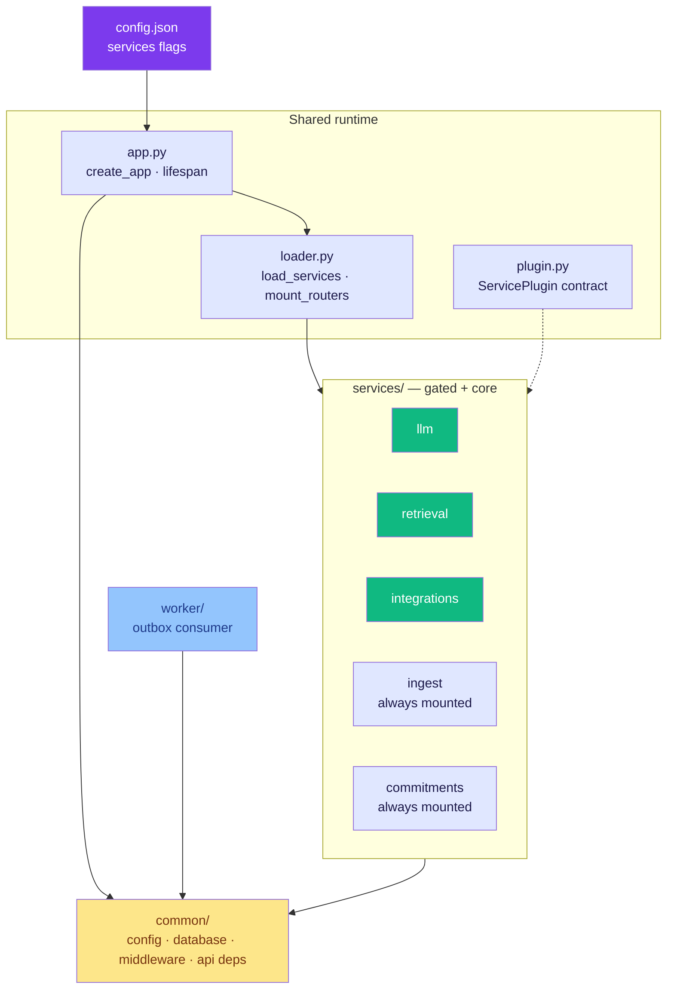

<div align="center">

# MindOS

**One codebase · modular services · enabled in `config.json`**

<br/>


<br/>

[Architecture](#architecture) ·
[Agent turn flow](#agent-turn-flow) ·
[Five-plane stack](#five-plane-stack) ·
[Layout](#repository-layout) ·
[Lifecycle](#lifecycle) ·
[Config](#config) ·
[Migrations](#migrations) ·
[Run](#run-and-test) ·
[**QUICKSTART**](./QUICKSTART.md)

</div>

<br/>

> **Tip —** Ops steps (Docker, `.env`, OAuth) live in **[QUICKSTART.md](./QUICKSTART.md)**. This file is the map of the repo.

<br/>

---

## Architecture

MindOS is a **modular monolith**: HTTP routes and background work are grouped by **service packages**. `config.json` toggles optional modules; `loader.py` imports only enabled ones and mounts their routers under `/v1`.



| Part | Responsibility |
| --- | --- |
| `plugin.py` + `loader.py` | `ServicePlugin` contract; load LLM gateway + optional modules; mount `/v1` routers |
| `common/` | Config (`.env` + `config.json`), Postgres session/models, rate limit, shared FastAPI deps |
| `services/<name>/` | One package per domain: `plugin.py`, `api/routes.py` when HTTP, domain code beside it |
| `worker/` | Polls `outbox_events`, runs `artifact.process` (embeddings + commitments) |
| `api/` | App-level routes only: `/health`, `/v1/meta` |

**Design rules (current):**

1. Optional services are **not imported** when disabled in `config.json` (`integrations`, `graph`, `agents`, optional `retrieval` embed path).
2. `common/` does not import `services/` (except via FastAPI deps at request time).
3. Core pipeline routes (**ingest**, **search**, **commitments**) stay mounted so the MVP works without flipping every flag.
4. Secrets and LLM keys come from **`.env`**; feature flags from **`config.json`**.

---

## Agent turn flow

Every chat turn (TUI `mindos chat`, `POST /v1/chat`, or `POST /v1/agents/run`) goes through **`handle_turn`** in `services/agents/core/turn/orchestrate.py`. Sessions and messages live in Postgres; the worker path (ingest → outbox → embed) feeds retrieval the agent reads on later turns.

Every turn uses the **five-plane** stack: structured **`TurnPlan`**, RRF **`EvidencePack`**, **ContextCompiler**, verifier, and subagents ([Five-plane stack](#five-plane-stack)). Run **`uv run alembic upgrade head`** once for `turn_logs` / `chat_session_state`.

```mermaid
flowchart TB
    in["CLI or HTTP<br/>handle_turn"]:::in
    sess["Session + history<br/>sessions.py"]:::core
    prep["Turn plan<br/>TurnPlan JSON"]:::route
    gate{"In scope?"}:::dec
    oos["Tier 0<br/>clarify / sorry"]:::end
    ret["Retrieval<br/>prefetch and/or RRF EvidencePack"]:::ret
    deep{"Tier 2?<br/>writes / tools / escalate"}:::dec
    synth["Tier 1<br/>grounded converse / plan_synth"]:::synth
    da["Tier 2<br/>deepagents + subagents"]:::deep
    verify["Verifier<br/>citations / filenames"]:::ret
    fb["synth fallback<br/>deep_error / unavailable"]:::synth
    out["append message<br/>sources · turn_log · session_state"]:::end

    in --> sess --> prep --> gate
    gate -->|no| oos
    gate -->|yes| ret --> deep
    deep -->|no| synth --> verify --> out
    deep -->|yes| da
    da -->|error / unavailable| fb --> out
    da -->|ok| verify --> out
    oos --> out

    classDef in fill:#6366F1,color:#fff
    classDef core fill:#E0E7FF,color:#1E1B4B
    classDef route fill:#A78BFA,color:#fff
    classDef dec fill:#FDE68A,color:#78350F
    classDef ret fill:#10B981,color:#fff
    classDef synth fill:#38BDF8,color:#1E3A8A
    classDef deep fill:#F97316,color:#fff
    classDef end fill:#94A3B8,color:#fff
```

| Step | Code | What it decides |
| --- | --- | --- |
| **Turn plan** | `routing/turn_plan_llm.py` | Scope, intent, task, retrieval queries; **`TurnPlan`** JSON (`writes_external`, `domains`, `confidence`). |
| **Retrieval** | `retrieval/core/pipeline.py` + `turn/turn_retrieval.py` (mail live legs) | **RRF** fusion → **`EvidencePack`**; Gmail live prefetch without duplicating hybrid search. |
| **Tier 1 synth** | `converse/converse_synth.py` + `context/compiler.py` | **ContextCompiler** budgets + deterministic **verifier**. |
| **Tier 2 deep** | `graph/core/deep_agent.py` + `graph/core/subagents.py` | **researcher**, **calendar-operator**, **file-scout**; `interrupt_on` for destructive ops. |
| **Persistence** | `session/sessions.py`, session state, `turn_logs` | Messages, session state, citations, `turn_log`. |

**Gates:** `config.json` must enable `agents`, `retrieval`, and `llm` for chat; deep execution needs `graph` and `uv sync --extra agents` (or `--extra cli`).

### Tools (deep agent only)

**Converse / plan synth** has no callable tools—only prefetched / compiled evidence and the LLM.

**Deep agent** loads tools from `backend/mcp_servers.json` via `integrations/mcp/registry.py`. Built-in packs are in-process. The `deepagents` runtime also exposes **`write_todos`** and **`task`** for subagents.

#### Personal pack (agent-facing)

| Tool | Notes |
| --- | --- |
| `search` | Indexed mail + notes; `sources`, `detail=concise\|full` |
| `calendar_query` / `calendar_change` | Reads / writes; `interrupt_on` for writes |
| `memory_search` / `memory_write` | Explicit remember; scored recall |
| `read_url` | Public URL/PDF |
| `commitments` | Open commitments |

Gmail sync, outbox, and OAuth status are **CLI/HTTP/worker only**, not agent tools. Filesystem + convert packs unchanged (`mindos_fs_*`, `mindos_convert_*`). Filesystem honors `agents.filesystem` / `MINDOS_FS_ROOTS`.

---

## Five-plane stack

Bootstrap:

```bash
uv sync --extra agents   # or --extra cli (includes Postgres checkpointer)
uv run alembic upgrade head
```

### Five planes

| Plane | What changed |
| --- | --- |
| **Engine** | Structured **`TurnPlan`** JSON planner; three tiers (0 clarify, 1 grounded answer, 2 agent). Verb-regex deep overrides narrowed; `deep_error` falls back to synth. |
| **Retrieval** | Parallel hybrid / memories / commitments → **RRF** fusion → local embed rerank → **`EvidencePack`** with `eid` citations. |
| **Context** | **`ContextCompiler`**: token budgets, stable prefix first, evidence ephemeral on deep path (not re-injected into checkpointed user text). Prompts in `services/context/prompts/`. |
| **Memory** | Sentence-level proposed memories (sent mail / user chat only); scored recall; post-turn extractor; `chat_session_state` + extended `memories` / `session_summaries` schema. |
| **Verification** | Deterministic checks for cited `eid`s, filenames, URLs, emails, amounts, dates; caveat when claims fail. |

### Subagents

| Subagent | Role | Tools |
| --- | --- | --- |
| **researcher** | Multi-hop evidence; keeps noise out of lead context | `search`, mail/URL read |
| **calendar-operator** | Schedule reads/writes + approvals | `calendar_query`, `calendar_change` (`interrupt_on`) |
| **file-scout** | Local disk hunt when the index misses | `files_find`, `files_read` (read-only; no `/` scans) |

### Observability and durability

- **`turn_logs`** — tier, evidence ids, verifier result, spend
- **`BudgetGuard`** — records estimated USD spend (caps actually fire)
- **Gateway** — keeps prompt **tail** (user question); higher synth output budget
- **Checkpointer** — Postgres when `langgraph-checkpoint-postgres` is installed; else in-memory
- **Eval seed** — `backend/eval/datasets/routing_smoke.jsonl` (expand with Phase 1 retrieval metrics)

### Improvements shipped (summary)

- Fix: invented-filename path has a code verifier, not prompt-only rules
- Fix: `/project/AGENTS.md` no longer contaminates the assistant; `/project/` only if `MINDOS_PROJECT_ROOT` is set
- Fix: memory ingest no longer stores 1000-char artifact slices as approved “user” memories
- Speed: one retrieval pipeline per turn (vs sequential prefetch legs + duplicate embeds on the hot path as before)
- UX: calendar/file destructive tools pause via `interrupt_on` when a durable checkpointer is available
- Cost: smaller domain-scoped tool set; sync tools removed from the agent loop

---

## Repository layout

| Layer | Path | Contents |
| --- | --- | --- |
| Entry | `backend/app.py`, `backend/config.json` | FastAPI factory, lifespan, `/health` |
| Framework | `plugin.py`, `loader.py` | Plugin contract + service load/mount |
| Common | `common/config/`, `common/database/`, `common/middleware/`, `common/api/`, `common/domain/` | Settings, models, sessions, outbox, deps |
| Services | `services/<name>/` | See tree below |
| Worker | `worker/` | Outbox consumer + handlers |
| Schema | `backend/schema-core.sql`, `backend/alembic/` | Reference SQL + migrations |
| Ops | `docker-compose.yml`, `backend/infra/docker/`, `Makefile` | Lean stack |

```text
backend/
├── app.py                      # create_app() — uvicorn backend.app:app
├── plugin.py                   # ServicePlugin
├── loader.py                   # load_services(), mount_routers()
├── eval/                       # datasets + eval notes (routing smoke seed)
├── api/
│   ├── health.py               # GET /health
│   └── meta.py                 # GET /v1/meta
├── common/
│   ├── config_loader/          # config.json schema + .env settings
│   ├── database/               # models, session, lifecycle, outbox
│   ├── middleware/             # rate_limit
│   ├── api/deps.py             # db_session, require_integrations, llm_gateway
│   └── domain/                 # shared DTOs
├── services/
│   ├── llm/                    # gateway, providers, budget
│   ├── retrieval/              # hybrid, RRF pipeline, embed, search
│   ├── context/                # ContextCompiler + versioned prompts
│   ├── verification/           # deterministic grounding checks
│   ├── commitments/            # rules, extract
│   ├── ingest/                 # manual ingest, chunker
│   ├── memories/               # rules, persist, post-turn extract
│   ├── integrations/           # Google OAuth, Gmail, MCP tools
│   ├── graph/                  # deep_agent, deep_session, subagents
│   └── agents/                 # orchestrate, TurnPlan, converse, contracts
└── worker/
    ├── consumer.py
    └── handlers/artifact_process.py
```

Top-level layout:

```text
mind_os/
├── cli/                        # mindos TUI + commands (package)
├── backend/                    # API, worker, services, migrations, infra, data
├── tests/
├── .env                        # secrets + DATABASE_URL
├── alembic.ini                 # → backend/alembic/
└── docker-compose.yml
```

Primary UX is the **terminal** (`uv run mindos` / `mindos chat`). Sessions persist in Postgres; Tab opens history. Complex turns route to Deep Agents when `--extra agents` is installed.

---

## Lifecycle


| Stage | What happens |
| --- | --- |
| Boot | `create_app()` mounts core + gated routers; lifespan opens DB pool and builds `app.state.services` |
| Request | Routes use `common/api/deps.py`; LLM via `app.state.services.llm` when `llm: true` |
| Ingest | API writes artifact + chunks + keyword index + outbox event |
| Worker | `artifact.process` → optional embed (`retrieval: true`) → commitment extraction |

---

## Config

**`config.json`** (feature flags):

```json
{
  "services": {
    "llm": true,
    "retrieval": false,
    "graph": false,
    "agents": false,
    "integrations": true
  }
}
```

| Flag | When enabled |
| --- | --- |
| `llm` | `ProviderGateway` on `app.state.services.llm` |
| `retrieval` | Worker embeds chunks; optional extras in `pyproject` |
| `integrations` | `/v1/integrations/google/*` routes |
| `graph`, `agents` | Status + `POST /agents/run` when enabled |

**`.env`** — `DATABASE_URL`, `MINDOS_*`, `GOOGLE_*`, OAuth vars. See QUICKSTART.

| Env | Purpose |
| --- | --- |
| `MINDOS_PROJECT_ROOT` | Optional explicit `/project/` mount (never the repo cwd by default) |
| `MINDOS_FS_ROOTS` | Allowed local filesystem roots for FS tools / file-scout |
| `MINDOS_LLM_*` | Mode, model names, daily/monthly USD caps (spend is recorded) |

Docker mounts host `./backend/config.json` over the packaged copy.

---

## Migrations

Schema source of truth: `backend/schema-core.sql`. Apply with Alembic:

```bash
uv run alembic upgrade head
```

Host Postgres from Docker is published on **`localhost:5433`** (avoids clash with a local Postgres on 5432). Alembic reads `DATABASE_URL` from `.env` via `get_settings()`.

---

## Run and test

```bash
uv sync --group dev
make test
uv run uvicorn backend.app:app --reload --port 8000
uv run backend-worker
```

| Endpoint | URL |
| --- | --- |
| Health | `GET /health` |
| Meta | `GET /v1/meta` |
| Manual ingest | `POST /v1/ingest/manual` |
| Search | `GET /v1/search?q=` (hybrid when `embed` extra + vectors exist) |
| Commitments | `GET /v1/commitments` |
| Agent run | `POST /v1/agents/run` (`graph` + `agents` + `llm`) |
| Google OAuth | `GET /v1/integrations/google/start` (needs `integrations: true`) |

```bash
docker compose --profile lean up -d --build
uv run alembic upgrade head
```

---

## Services (HTTP surface)

| Service | `config.json` | Prefix | Notes |
| --- | --- | --- | --- |
| ingest | always | `/v1/ingest/*` | Vault + chunks + outbox |
| retrieval | always (keyword); embed gated | `/v1/search` | keyword search always; vectors need `retrieval: true` |
| commitments | always | `/v1/commitments` | Populated by worker |
| integrations | `integrations` | `/v1/integrations/*` | Gmail read + OAuth |
| llm | `llm` | — | Used by worker/gateway, no public router |
| tensions | `tensions` | `/v1/tensions` | Rule-detected conflicts |
| memories | `memories` | `/v1/memories` | Worker + search sidecar |
| graph | `graph` | `/v1/graph/status` | LangGraph optional (`--extra agents`) |
| agents | `agents` | `POST /v1/agents/run` | Hybrid retrieval + synth |

---

## Phases (MVP + turn stack)

| Phase | Scope | Status |
| --- | --- | --- |
| 1–2 | Ingest, keyword search, outbox, commitments | done |
| 3 | Google OAuth + Gmail | done |
| 4 | Tensions | done |
| 5 | Memories + integration hardening | done |
| 6 | Hybrid search, `due_at`, agents/graph | done |
| **Turn stack** | TurnPlan, RRF retrieval, ContextCompiler, verifier, memory plane, subagents (researcher / calendar-operator / file-scout), Postgres checkpointer | **default** (requires `alembic upgrade head`) |

Pre-ship: **[SHIP_CHECKLIST.md](./SHIP_CHECKLIST.md)**. Tests: `tests/unit` + import sweep `tests/src/test_mirror.py`. Overview: **[docs/PROJECT_OVERVIEW.md](./docs/PROJECT_OVERVIEW.md)**.

