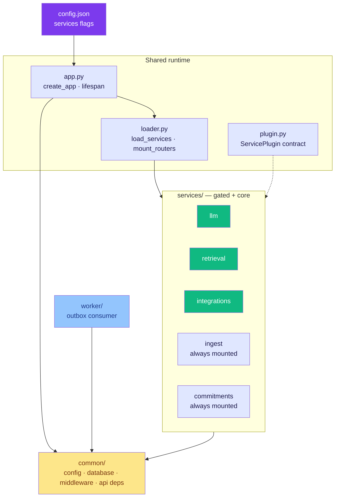
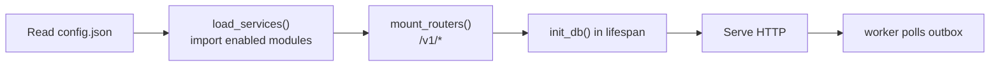

<div align="center">

# MindOS

**One codebase · modular services · enabled in `config.json`**

<br/>


<br/>

[Architecture](#architecture) ·
[Layout](#repository-layout) ·
[Lifecycle](#lifecycle) ·
[Config](#config) ·
[Migrations](#migrations) ·
[Run](#run-and-test) ·
[**QUICKSTART**](./QUICKSTART.md)

</div>

<br/>

> **Tip —** Ops steps (Docker, `.env`, OAuth) live in **[QUICKSTART.md](./QUICKSTART.md)**. This file is the map of the repo.

<br/>

---

## Architecture

MindOS is a **modular monolith**: HTTP routes and background work are grouped by **service packages**. `config.json` toggles optional modules; `loader.py` imports only enabled ones and mounts their routers under `/v1`.



| Part | Responsibility |
| --- | --- |
| `plugin.py` + `loader.py` | `ServicePlugin` contract; load LLM gateway + optional modules; mount `/v1` routers |
| `common/` | Config (`.env` + `config.json`), Postgres session/models, rate limit, shared FastAPI deps |
| `services/<name>/` | One package per domain: `plugin.py`, `api/routes.py` when HTTP, domain code beside it |
| `worker/` | Polls `outbox_events`, runs `artifact.process` (embeddings + commitments) |
| `api/` | App-level routes only: `/health`, `/v1/meta` |

**Design rules (current):**

1. Optional services are **not imported** when disabled in `config.json` (`integrations`, `graph`, `agents`, optional `retrieval` embed path).
2. `common/` does not import `services/` (except via FastAPI deps at request time).
3. Core pipeline routes (**ingest**, **search**, **commitments**) stay mounted so the MVP works without flipping every flag.
4. Secrets and LLM keys come from **`.env`**; feature flags from **`config.json`**.

---

## Repository layout

| Layer | Path | Contents |
| --- | --- | --- |
| Entry | `backend/app.py`, `backend/config.json` | FastAPI factory, lifespan, `/health` |
| Framework | `plugin.py`, `loader.py` | Plugin contract + service load/mount |
| Common | `common/config/`, `common/database/`, `common/middleware/`, `common/api/`, `common/domain/` | Settings, models, sessions, outbox, deps |
| Services | `services/<name>/` | See tree below |
| Worker | `worker/` | Outbox consumer + handlers |
| Schema | `backend/schema-core.sql`, `backend/alembic/` | Reference SQL + migrations |
| Ops | `docker-compose.yml`, `backend/infra/docker/`, `Makefile` | Lean stack |

```text
backend/
├── app.py                      # create_app() — uvicorn backend.app:app
├── plugin.py                   # ServicePlugin
├── loader.py                   # load_services(), mount_routers()
├── api/
│   ├── health.py               # GET /health
│   └── meta.py                 # GET /v1/meta
├── common/
│   ├── config_loader/          # config.json schema + .env settings
│   ├── database/               # models, session, lifecycle, outbox
│   ├── middleware/             # rate_limit
│   ├── api/deps.py             # db_session, require_integrations, llm_gateway
│   └── domain/                 # shared DTOs
├── services/
│   ├── llm/                    # gateway, providers, budget · plugin.py
│   ├── retrieval/              # search, embed · api/routes.py
│   ├── commitments/            # rules, extract · api/routes.py
│   ├── ingest/                 # manual ingest, chunker · api/routes.py
│   ├── integrations/           # Google OAuth, Gmail sync · api/routes.py
│   ├── graph/                  # stub plugin
│   └── agents/                 # stub plugin
└── worker/
    ├── consumer.py
    └── handlers/artifact_process.py
```

Top-level layout:

```text
mind_os/
├── cli/                        # mindos TUI + commands (package)
├── backend/                    # API, worker, services, migrations, infra, data
├── tests/
├── .env                        # secrets + DATABASE_URL
├── alembic.ini                 # → backend/alembic/
└── docker-compose.yml
```

Primary UX is the **terminal** (`uv run mindos` / `mindos chat`). Sessions persist in Postgres; Tab opens history. Complex turns route to Deep Agents when `--extra agents` is installed.

---

## Lifecycle



| Stage | What happens |
| --- | --- |
| Boot | `create_app()` mounts core + gated routers; lifespan opens DB pool and builds `app.state.services` |
| Request | Routes use `common/api/deps.py`; LLM via `app.state.services.llm` when `llm: true` |
| Ingest | API writes artifact + chunks + FTS + outbox event |
| Worker | `artifact.process` → optional embed (`retrieval: true`) → commitment extraction |

---

## Config

**`config.json`** (feature flags):

```json
{
  "services": {
    "llm": true,
    "retrieval": false,
    "graph": false,
    "agents": false,
    "integrations": true
  }
}
```

| Flag | When enabled |
| --- | --- |
| `llm` | `ProviderGateway` on `app.state.services.llm` |
| `retrieval` | Worker embeds chunks; optional extras in `pyproject` |
| `integrations` | `/v1/integrations/google/*` routes |
| `graph`, `agents` | Status + `POST /agents/run` when enabled |

**`.env`** — `DATABASE_URL`, `MINDOS_*`, `GOOGLE_*`, OAuth vars. See QUICKSTART.

Docker mounts host `./backend/config.json` over the packaged copy.

---

## Migrations

Schema source of truth: `backend/schema-core.sql`. Apply with Alembic:

```bash
uv run alembic upgrade head
```

Host Postgres from Docker is published on **`localhost:5433`** (avoids clash with a local Postgres on 5432). Alembic reads `DATABASE_URL` from `.env` via `get_settings()`.

---

## Run and test

```bash
uv sync --group dev
make test
uv run uvicorn backend.app:app --reload --port 8000
uv run backend-worker
```

| Endpoint | URL |
| --- | --- |
| Health | `GET /health` |
| Meta | `GET /v1/meta` |
| Manual ingest | `POST /v1/ingest/manual` |
| Search | `GET /v1/search?q=` (hybrid when `embed` extra + vectors exist) |
| Commitments | `GET /v1/commitments` |
| Agent run | `POST /v1/agents/run` (`graph` + `agents` + `llm`) |
| Google OAuth | `GET /v1/integrations/google/start` (needs `integrations: true`) |

```bash
docker compose --profile lean up -d --build
uv run alembic upgrade head
```

---

## Services (HTTP surface)

| Service | `config.json` | Prefix | Notes |
| --- | --- | --- | --- |
| ingest | always | `/v1/ingest/*` | Vault + chunks + outbox |
| retrieval | always (FTS); embed gated | `/v1/search` | FTS always; vectors need `retrieval: true` |
| commitments | always | `/v1/commitments` | Populated by worker |
| integrations | `integrations` | `/v1/integrations/*` | Gmail read + OAuth |
| llm | `llm` | — | Used by worker/gateway, no public router |
| tensions | `tensions` | `/v1/tensions` | Rule-detected conflicts |
| memories | `memories` | `/v1/memories` | Worker + search sidecar |
| graph | `graph` | `/v1/graph/status` | LangGraph optional (`--extra agents`) |
| agents | `agents` | `POST /v1/agents/run` | Hybrid retrieval + synth |

---

## Phases (MVP)

| Phase | Scope | Status |
| --- | --- | --- |
| 1–2 | Ingest, FTS, outbox, commitments | done |
| 3 | Google OAuth + Gmail | done |
| 4 | Tensions | done |
| 5 | Memories + integration hardening | done |
| 6 | Hybrid search, `due_at`, agents/graph | done |

Pre-ship: **[SHIP_CHECKLIST.md](./SHIP_CHECKLIST.md)**. Tests: `tests/unit` + import sweep `tests/src/test_mirror.py`.

