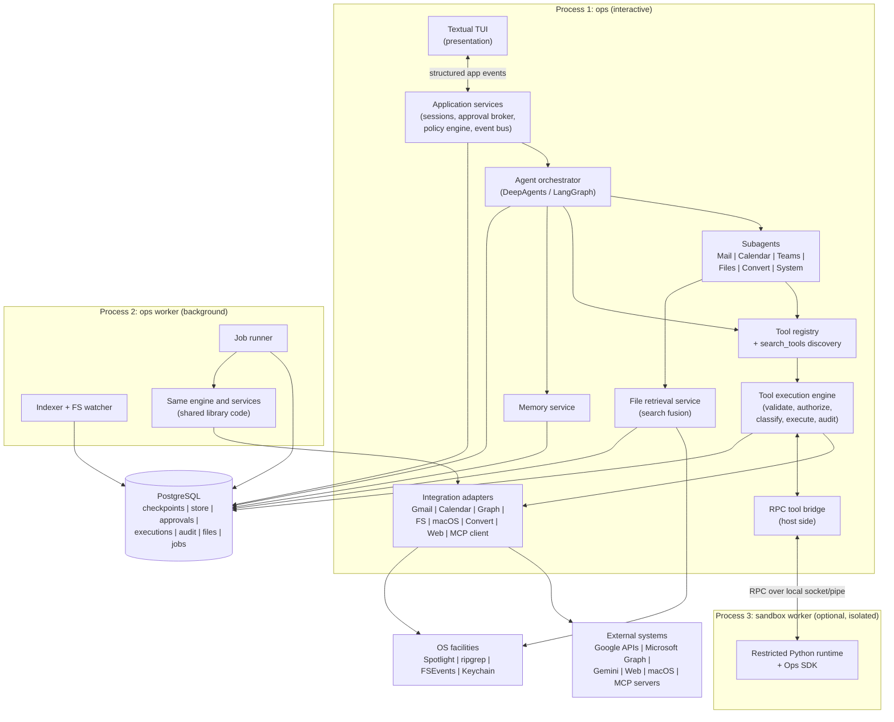
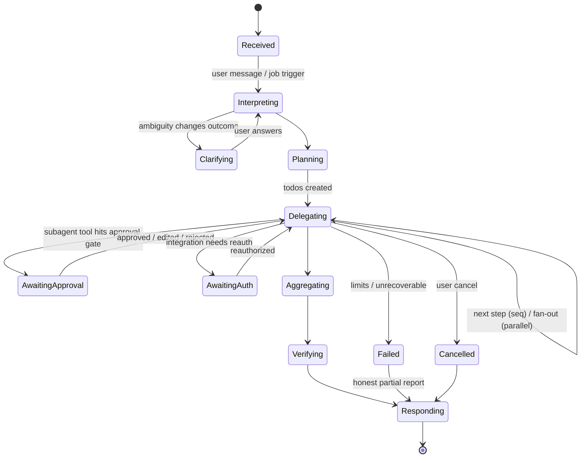
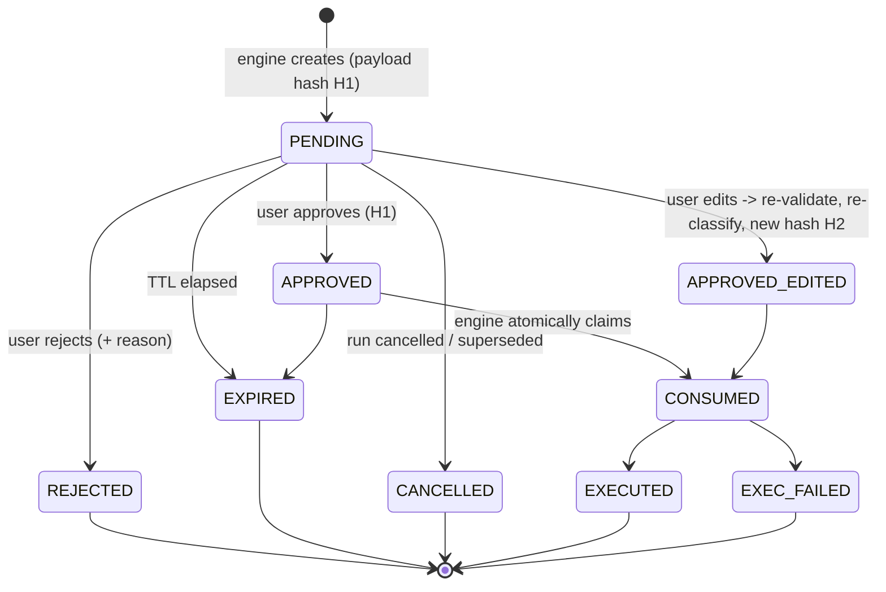
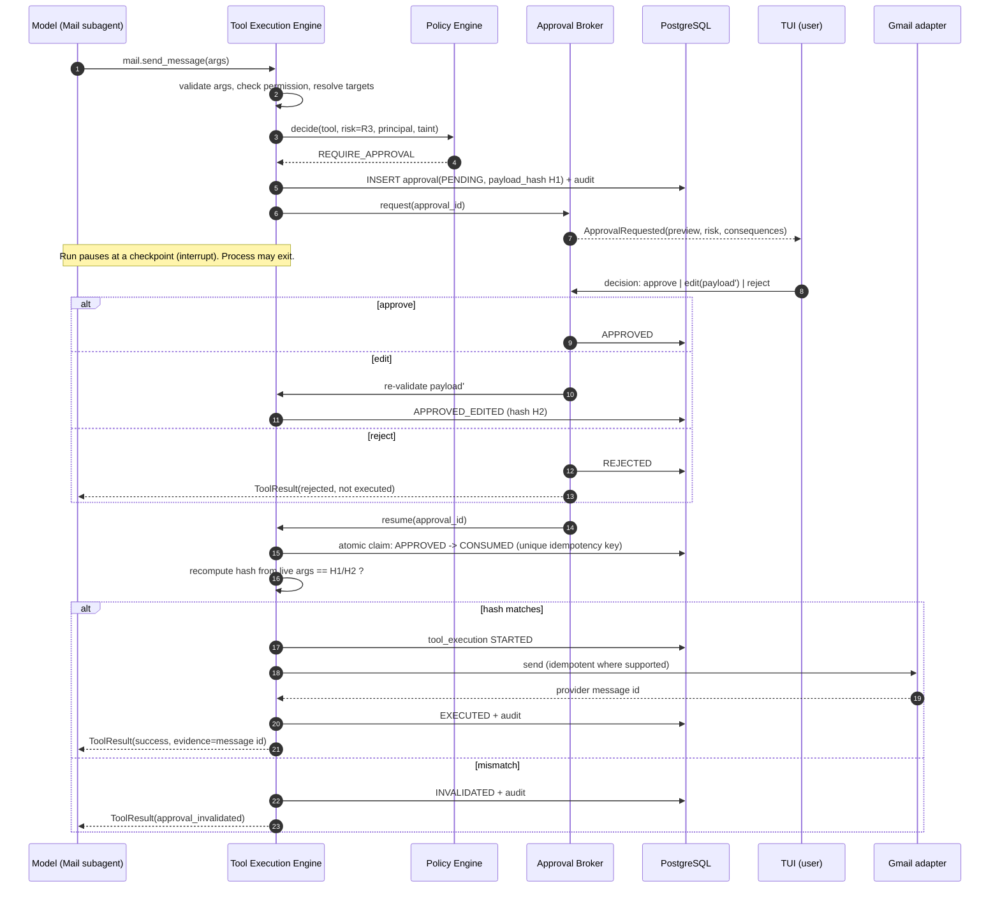

# ARCHITECTURE

> **Status:** Proposed design for a repository that is currently empty. Nothing described here is implemented. Terms such as "must" define the target contract.
>
> Product intent and principles: [MISSION.md](MISSION.md). Setup, repository layout, and commands: [README.md](README.md).

**Conventions.** *Module* = logical package in the single codebase. *Process* = separate OS process at runtime. *Principal* = who a tool invocation is attributed to (`USER`, `AGENT`, `JOB`, `SANDBOX`). Model IDs and library versions are **configuration**, never hardcoded in code or docs (see [§17.3](#173-verification-status-and-open-decisions)).

## Contents

1. [Architectural Overview](#1-architectural-overview)
2. [Principles and Module Boundaries](#2-architectural-principles-and-module-boundaries)
3. [Agent Orchestration](#3-agent-orchestration-architecture)
4. [Tool Architecture and Programmatic Execution](#4-tool-architecture-and-programmatic-execution)
5. [Human-in-the-Loop Approvals](#5-human-in-the-loop-approval-architecture)
6. [Authentication and Integration Lifecycle](#6-authentication-and-integration-lifecycle)
7. [External Integrations](#7-external-integration-architecture)
8. [Filesystem Intelligence and Retrieval](#8-filesystem-intelligence-and-retrieval)
9. [Memory and Context](#9-memory-and-context-architecture)
10. [PostgreSQL](#10-postgresql-architecture)
11. [Retry, Resilience, Recovery](#11-retry-resilience-and-recovery)
12. [Background Jobs](#12-background-jobs-and-scheduling)
13. [Textual TUI](#13-textual-tui-architecture)
14. [Security and Trust Boundaries](#14-security-and-trust-boundaries)
15. [Observability and Audit](#15-observability-and-audit)
16. [Testing and Evaluation](#16-testing-and-evaluation)
17. [Architectural Evolution](#17-architectural-evolution)

---

## 1. Architectural Overview

### 1.1 Why a strict modular monolith

One user, one machine, one deployable. The hard problems here are correctness of side effects, resumability, and trust boundaries, not horizontal scale. A modular monolith gives:

- **Transactional integrity** between approvals, tool executions, and audit records (one database, one transaction).
- **Simple local operation**: one install, one config, no service mesh.
- **Enforceable boundaries** via import rules checked in CI (§2.3), without network hops.

Separate processes exist **only where isolation or lifecycle demands it**: the background worker (survives TUI exit), the sandbox worker (untrusted code), and external MCP servers (third-party code).

### 1.2 Components and runtime processes



| Logical modules (one codebase) | Separate runtime processes |
|---|---|
| presentation, application, domain, agents, tools, integrations, persistence, infra | `ops` (TUI + agent runtime), `ops worker`, sandbox worker (optional), PostgreSQL, MCP servers |

The interactive process and the worker share library code but **never share in-memory state**; PostgreSQL is the coordination point.

---

## 2. Architectural Principles and Module Boundaries

### 2.1 Layers

| Layer | Package (proposed) | Owns | May depend on |
|---|---|---|---|
| Presentation | `presentation/` | Textual widgets, screens, theme, input handling. Renders events; emits user intents. | `application` (public API, event types) |
| Application | `application/` | Use cases, session/run lifecycle, approval broker, policy engine, event bus, scheduling service. | `domain`, ports |
| Domain | `domain/` | Entities, value objects, risk model, policy model, tool/approval/memory contracts, **ports** (interfaces). Pure Python; no I/O. | nothing internal |
| Agent orchestration | `agents/` | Orchestrator, subagent definitions, prompts, context assembly, planning middleware. | `domain`, `tools` (registry API), `application` ports |
| Tool execution | `tools/` | Registry, discovery, validation, executor, normalization, namespaces. | `domain`, `application` ports |
| Integration | `integrations/` | Adapters implementing domain ports for Gmail, Calendar, Graph, filesystem, macOS, conversion, web, MCP. | `domain`, `infra` |
| Persistence | `persistence/` | Repositories, migrations, LangGraph checkpointer/store wiring. | `domain`, `infra` |
| Infrastructure | `infra/` | Config, logging, secrets (Keychain), HTTP, clocks, ID generation. | nothing internal except `domain` types |

`sandbox/` (host-side bridge and worker entrypoint) and `workers/` (job runner, indexer, watcher) are **composition roots / runtimes**, not layers. `bootstrap/` is the only place that wires concrete adapters to ports.

### 2.2 Dependency direction

```text
presentation -> application -> domain <- integrations
                    |            ^   <- persistence
                    v            |
                 agents ----> tools ---- (ports only) ----> domain
bootstrap -> everything (wiring only)
```

Rules: dependencies point toward `domain`. `domain` imports nothing from the repo. Layers communicate through **domain-defined contracts** (Pydantic models and `Protocol` ports).

### 2.3 Enforced restrictions

| Restriction | Enforcement |
|---|---|
| No circular dependencies | `import-linter` contracts + CI failure. |
| No business logic in UI | `presentation` may import only application facade and event types; widgets contain no policy, parsing, or provider code. |
| No direct provider calls from domain | `domain` forbids imports of `googleapiclient`, `msal`, `httpx`, `psycopg`, `langchain*`, etc. |
| No bypass of authorization | Integration adapters are constructed only by `bootstrap` and injected **into the execution engine**. No other module can import an adapter (forbidden-import contract). |
| No unrestricted cross-module access | Each package exposes a public `__init__` API; deep imports across packages are forbidden. |
| No uncontrolled shared state | No module-level mutable globals. State lives in PostgreSQL, in an explicit service object, or in a LangGraph state. Cross-task communication uses the event bus or DB. |

Cross-module contracts are **typed**: Pydantic v2 models for commands, events, tool I/O; `Protocol` for ports. Contract changes are versioned (§4.3, §13.2).

---

## 3. Agent Orchestration Architecture

### 3.0 Agent runtime port

DeepAgents is pre-1.0 and changes quickly. The orchestrator and subagents run behind a domain port, `AgentRuntime` (`start(run)`, `resume(thread_id, decision)`, `cancel(run_id)`, event stream out). DeepAgents/LangGraph is one adapter in `agents/`; a plain LangGraph/LangChain agent is the fallback adapter. Nothing outside `agents/` imports framework types. Whether DeepAgents' built-in filesystem/shell tools can be fully removed is decided by the Phase 0 spike (§17.3); if not, DeepAgents is dropped.

### 3.1 Responsibilities

The orchestrator (a DeepAgents/LangGraph agent) is a **planner and router**, not an executor of integration calls. It:

1. Interprets intent and resolves ambiguity (may call `ask_user`).
2. Plans and maintains a todo list (`write_todos`).
3. Selects subagent(s) and passes a **task brief** plus references.
4. Aggregates subagent **result contracts**; verifies claims against evidence before reporting.
5. Reads/writes memory through the memory tools.

It does **not** hold Gmail, Calendar, Graph, or filesystem-mutation tools. Reasons: (a) small tool surfaces select tools more accurately; (b) per-step token cost of tool schemas stays flat as integrations grow; (c) permissions attach to subagent namespaces, making least privilege structural; (d) context for bulky tool traffic stays inside the subagent.

**Orchestrator tool surface (target ≤ ~10):** `delegate(subagent, brief, context_refs)`, `write_todos`, `ask_user`, `search_tools` (meta-level, returns subagent/namespace suggestions), `memory_search`, `memory_write`, `web_search`, `read_artifact` (fetch an offloaded large result by ID).

### 3.2 Execution lifecycle



`AwaitingApproval` and `AwaitingAuth` are **checkpointed pauses** (LangGraph interrupt + PostgreSQL checkpoint). The process may exit; resume reloads by `thread_id`.

### 3.3 Delegation, context, aggregation

| Aspect | Rule |
|---|---|
| Sequential | Used when step N depends on N-1's output. |
| Parallel | Used for independent read-heavy work (e.g., Mail search and Calendar lookup). Side-effecting steps are not parallelized across the same resource. Max concurrency is configured (`agents.max_parallel_subagents`). |
| Context passing | A `TaskBrief` (goal, constraints, relevant memory excerpts, entity IDs, expected result schema). Subagents do **not** inherit the orchestrator's message history. |
| Isolation | Each subagent invocation has its own message history; only its **final `SubagentResult`** returns to the orchestrator. Large payloads are stored as artifacts and returned by reference. |
| Result contract | `SubagentResult { status: success|partial|failed|needs_input, summary, evidence[], artifacts[], pending_approvals[], errors[] }`. `evidence` holds verifiable identifiers (message IDs, event IDs, file paths + hashes). A `success` without evidence for a side effect is rejected by the orchestrator layer. |
| Limits | Per-run caps: steps, subagent depth (subagents cannot spawn subagents), wall-clock deadline, token budget, tool-call budget. Exceeding a cap yields `partial` with a precise statement of what remains. |
| Cancellation | Cooperative via LangGraph cancellation plus engine-level: in-flight idempotent reads are abandoned; in-flight side effects are allowed to reach a known state, then reconciled (§11.4). |
| Failure recovery | Subagent failure returns structured errors. The orchestrator may retry with a changed brief **once**, reroute, ask the user, or report partial completion. It must not loop. |

### 3.4 Subagents

| Subagent | Owns (namespace) | Permissions / boundaries | Notes |
|---|---|---|---|
| **Mail** | `mail.*` (Gmail) | Read automatic; drafts policy-dependent; send approval-gated; no filesystem or Calendar tools. | Message bodies are untrusted data. |
| **Calendar** | `calendar.*` | Read automatic; create/update policy-dependent; invitations to others approval-gated. | Time zone handled in code, not by the model. |
| **Teams** | `teams.*` (Graph) | Read automatic; send approval-gated. | Work/school accounts only (§7.3). |
| **Files** | `files.*` | Reads within allowed roots; edits via diff + policy; delete approval-gated. Excluded directories invisible. | Owns the unified search interface (§8). |
| **Convert** | `convert.*` | Reads input from allowed roots; writes to a designated output location; no network. | Pure transformation; deterministic. |
| **System** | `system.*` (macOS) | Allowlist of actions (e.g., open app, reminders, notifications). No arbitrary shell. Every action approval-gated unless allowlisted as safe. | Highest scrutiny; smallest surface. |

Each subagent is defined declaratively (name, description, system prompt, owned namespace, always-loaded tools, `interrupt` policy hook, model tier). Subagents can use a cheaper model tier from config.

### 3.5 Reasoning (thinking) models

Gemini thinking models are used so the agent plans and verifies before acting. Reasoning is a **quality and cost control**, never a security boundary (MISSION principle 5 still holds: code decides whether and how a tool runs).

| Topic | Rule |
|---|---|
| Control parameter | Gemini 3+ uses `thinking_level` (`minimal`, `low`, `medium`, `high`, and `xhigh` on models that list it). Gemini 2.5 uses `thinking_budget` (`0` off, `-1` dynamic, or a token cap). Only the LLM adapter knows this difference. The domain sees one value, `reasoning_effort`. |
| Capability discovery | Supported levels and the default come from the model profile at startup (`reasoning_effort_levels`, `reasoning_effort_default`), not from hardcoded tables. An unsupported level falls back to the nearest lower supported level and logs a warning. |
| Per-role defaults (config) | Orchestrator planning and result verification: high. Subagent tool-selection steps: low or medium. Routing, titling, summarization: minimal or low. Defaults are chosen from eval results (§16), not guesses. |
| Per-run override | The user may raise or lower effort with `/think <level>`. This changes cost and latency only. It cannot change policy. |
| Visibility | `include_thoughts=true` returns thought **summaries**. They stream as `ThinkingDelta` events and render collapsed (§13). They are display data only. |
| Thought signatures | Gemini 3+ returns encrypted signatures that must be sent back with the original message during a tool-calling loop; a reconstructed message can be rejected. Rule: within a run, the **original provider message object is stored in the checkpoint and replayed unchanged**. Context compaction and summarization must never rewrite messages of the active tool loop. Only the LLM adapter handles signatures. |
| Trust | Thought text is model output: untrusted, redacted before logging, not stored in audit bodies by default (hash and token count only), and never passed between agents. A subagent returns only its `SubagentResult`, never its thoughts. |
| Cost and latency | Thinking tokens are billed as output tokens. `provider_usage` records reasoning tokens separately. Token budgets (§3.3) count them. The run deadline covers them. `UsageUpdated` carries them to the status line. |
| Retry | Same as other LLM calls (§11.2). A step that exhausts its thinking budget without output is a provider error, retried at most once at a lower level. |
| Evaluation | Golden-dataset evals run each role at two or more levels and report pass rate, steps, and cost. A level is raised only when it measurably improves pass rate. |

---

## 4. Tool Architecture and Programmatic Execution

### 4.1 Tool kinds

| Kind | Definition | Passes through the engine? |
|---|---|---|
| **Direct application tool** | Orchestrator-level tool implemented in-process (`write_todos`, `memory_*`, `ask_user`, `delegate`). | Yes (lightweight path; audited). |
| **Model-requested function call** | Any tool call emitted by the LLM, regardless of which tool. | **Always.** The model proposes; the engine disposes. |
| **Application-triggered programmatic call** | Initiated by code with no LLM: scheduler, indexer, UI action (e.g., "Open file"), sandbox RPC. | **Always**, with principal `JOB`/`USER`/`SANDBOX`. |
| **Subagent tool** | Tool owned by a namespace and visible to that subagent. | Yes. |
| **Internal tool** | No external effect (todos, memory read, artifact read). Risk class `R0`. | Yes (cheap path). |
| **External MCP tool** | Tool exposed by an MCP server, adapted into the registry. | Yes; default risk `R3` until explicitly classified; server allowlisted; description treated as untrusted. |

**Invariant:** `ToolExecutionEngine.execute(invocation)` is the *only* code path that reaches an integration adapter. Principals differ; the pipeline does not.

### 4.2 Tool lifecycle


| # | Stage | Detail |
|---|---|---|
| 1 | Registration | At startup, namespaces register `ToolSpec { name, namespace, version, summary, input_schema, output_schema, capabilities, default_risk, risk_classifier, idempotency, retry_policy, timeout, redactions }`. Duplicate names fail startup. |
| 2 | Discovery | Agents see a small always-loaded set. `search_tools(query, namespace?)` returns names + one-line summaries from a registry index (keyword + embedding over summaries). Restricted to tools the caller's **principal and namespace are permitted to see**. |
| 3 | Schema retrieval | `load_tools(names)` adds full JSON schemas to the agent's active tool set for subsequent model calls (middleware rebinds per step). Schemas are only returned for permitted tools. |
| 4 | Argument validation | Pydantic validation against `input_schema`; strict types; bounds (e.g., recipient count, path under allowed roots, date ranges). Failure returns a structured, model-readable error; the model may correct and retry within budget. |
| 5 | Permission validation | Principal + namespace + OAuth scope check + filesystem root check + integration state (`CONNECTED`?). Independent of what the model claims. |
| 6 | Risk classification | `RiskClassifier` computes `R0–R4` **from validated arguments and resolved targets** (e.g., send to new external recipient → higher; delete count; path sensitivity). The model's description of risk is ignored. |
| 7 | Approval determination | `PolicyEngine.decide(tool, risk, principal, taint, config)` → `ALLOW | REQUIRE_APPROVAL | DENY`. See §5. |
| 8 | Execution | Adapter call with deadline, retry policy per §11, idempotency key. Side-effect tools persist `tool_executions` row as `STARTED` **before** the call. |
| 9 | Result normalization | Output validated against `output_schema`; untrusted text fields wrapped/tagged; size-bounded; oversized results stored as artifacts and replaced by a reference + preview; secrets redacted. |
| 10 | Audit persistence | `tool_executions` and `audit_events` written in the same transaction as state transition. |
| 11 | Response delivery | Normalized result mapped to the provider's function-response format by the **LLM provider adapter** (e.g., Gemini 3.x requires function responses to match the preceding call's `id`, `name`, and count; this is handled only in the adapter). |

### 4.3 Initial tool strategy

1. **Subagents as namespaces.** Tools are grouped by owner; ownership is the permission unit.
2. **Coarse-grained tools.** Prefer `mail.search_messages`, `mail.get_thread`, `mail.create_draft`, `mail.send_message` over low-level API mirrors. Fewer, more meaningful tools reduce model error and step count.
3. **Dynamic `search_tools`** for the long tail within a namespace; keep always-loaded sets small.
4. **Validated I/O** with versioned schemas (`name@major`). Breaking changes bump the major and keep the old version resolvable until no checkpointed run references it.
5. **Explicit permissions** declared on every spec; no implicit inheritance.

### 4.4 Advanced programmatic execution (deferred)

Introduce **only when** measured workflows show tool-call chaining is too slow, costly, or error-prone (e.g., "label 400 threads by rule", "rename and convert 200 files"). Until then this section is a design reservation.

```text
Agent
  |  proposes code (a Python function using the Ops SDK)
  v
Code Generation
  v
Validation            (static checks: allowed imports, size, no dynamic exec; defense-in-depth, NOT the boundary)
  v
Isolated Sandbox      (separate process, no secrets, no network, scoped scratch FS, resource limits)
  v
Restricted Ops SDK    (ops.mail.search(...), ops.files.read(...); thin stubs that serialize requests)
  v
RPC Tool Bridge       (local socket/pipe; framed, size-limited, schema-validated messages)
  v
Authorization + Approval  (the same engine pipeline, principal=SANDBOX)
  v
Host-side Execution   (adapters run in the host process with the host's credentials)
```

**Design properties**

| Concern | Mechanism |
|---|---|
| Secrets | Sandbox never receives tokens, API keys, DB credentials, or environment passthrough. Adapters and credentials exist only on the host. |
| Network | No network namespace/egress from the sandbox. Anything needing the network is an RPC call that the host may deny. |
| Filesystem | Sandbox sees an ephemeral scratch directory. Input files are **staged (copied) by the host** after the engine authorizes the read; outputs are collected by the host after validation. No host path is mounted writable. |
| Resource limits | CPU time, memory, wall-clock, process count, open files, RPC call count, total RPC payload bytes, stdout bytes. Exceeding any terminates the sandbox and returns `partial`. |
| RPC | Length-prefixed JSON frames over a Unix domain socket or inherited pipe; each request carries `{run_id, seq, tool, args}`; bridge enforces max frame size, rate, and ordering; unknown tools rejected. |
| Independent host validation | The bridge hands every request to the engine. Schema validation, permission, risk, and policy run **again on the host**; nothing is trusted because "the sandbox said it was approved". |
| Reads vs effects | Reads execute immediately within quotas. **Side-effecting calls are deferred**: they are recorded as *proposed operations* in an operation set. |
| Batch approval | At the end of the run (or at explicit `ops.commit()`), the host presents one **batch approval** listing every proposed effect (with per-item diffs/targets). The user may approve all, approve a subset, edit items, or reject. Approved items execute individually, each bound to its own payload hash (§5.5). |
| Errors and partial results | Each operation returns `{status, value | error, retryable}`. Sandbox code can handle per-item errors. The final result to the agent is a structured summary: succeeded, failed, skipped, with evidence IDs. |

**The sandbox is never an alternative authorization path.** It has no capability the Ops SDK does not expose, and every Ops SDK call is an engine invocation. Backend selection (container vs. OS-level sandbox) is an open decision (§17.3); the contract above is independent of it.

---

## 5. Human-in-the-Loop Approval Architecture

### 5.1 Risk classes and default policy

| Class | Meaning | Examples |
|---|---|---|
| `R0` | Read-only, no external effect | search/read mail, search calendar, search files |
| `R1` | Local, reversible, or self-contained write | create draft, create tentative personal event, write to scratch/output dir |
| `R2` | Visible to others or hard to undo locally | create event with attendees, edit existing local file |
| `R3` | External communication or irreversible | send email, send Teams message, delete file |
| `R4` | Bulk or broadly destructive | many deletes, mass send, mass relabel/archive |

| Operation | Class (typical) | Expected policy |
|---|---|---|
| Search Gmail / Read email | R0 | Automatic |
| Create email draft | R1 | Policy-dependent (default: automatic) |
| Send email | R3 | Explicit approval |
| Search calendar | R0 | Automatic |
| Create calendar event | R1–R2 | Policy-dependent (no attendees: auto; with attendees: approval) |
| Send Teams message | R3 | Explicit approval |
| Edit local file | R2 | Show diff; approval per policy (default: approval outside designated workspace) |
| Delete files | R3 | Explicit approval |
| Bulk destructive operation | R4 | Detailed explicit approval (itemized list, counts, irreversibility notice) |

### 5.2 Policy ownership: the model cannot override it

- Policy lives in **user-owned configuration** (`policy.toml` under the app config directory) plus compiled defaults. It is loaded and enforced by `application.PolicyEngine`.
- The model has **no tool** that reads, writes, or relaxes policy. Policy changes happen only through user-initiated UI/CLI actions (`ops policy ...`), each audited.
- The engine can only **escalate** relative to config: *taint escalation* (§14.4) and the risk classifier may raise the requirement; nothing at runtime lowers it.
- Per-tool "always allow" grants are user-created, scoped (tool + constraints such as recipient domain or path root), optionally expiring, and revocable.
- Enforcement is **in the engine** (stage 7), not only in the agent framework. DeepAgents' `interrupt_on` (including conditional predicates) is used as the *pause/resume transport* for the TUI flow; the engine independently refuses to execute any `REQUIRE_APPROVAL` call that lacks a valid, unconsumed approval. A misconfigured graph therefore fails closed.

### 5.3 State machine



### 5.4 Behaviours

| Topic | Rule |
|---|---|
| Creation | Engine computes canonical payload + risk, writes `approvals` row (`PENDING`), emits `ApprovalRequested`, and pauses the run via LangGraph interrupt. Presentation shows tool, **resolved** targets, diff/preview, risk, and consequence text generated from structured data (not model prose). |
| Approve / edit / reject | Approve: executes exactly the shown payload. Edit: user modifies allowed fields; the edited payload is **re-validated and re-classified** (an edit can raise risk or be refused), gets a new hash, and the approval row links to the original. Reject: tool is not executed; the agent receives a structured "rejected by user: `<reason>`; not executed" result (using the framework's *reject* decision, not a synthetic success). |
| Expiration | Per-risk TTL (e.g., `R3` default minutes–hours; configurable). Expired approvals cannot execute; the run receives `expired` and may re-request. |
| Cancellation | Cancelling a run cancels its `PENDING` approvals. |
| Payload integrity | `payload_hash = SHA-256(canonical_json({tool, tool_version, principal, args_normalized, resolved_targets, base_state_hashes}))`. `base_state_hashes` includes, e.g., current content hash for file edits and draft revision IDs for send. At execution the engine **recomputes** the hash from the live arguments and compares; any mismatch → `APPROVAL_INVALIDATED`, no execution. |
| Duplicate prevention | `idempotency_key = hash(run_id, tool_call_id, payload_hash)` with a unique constraint; approval consumption is a single-row atomic `UPDATE … SET state='CONSUMED' WHERE id=$1 AND state IN ('APPROVED','APPROVED_EDITED') AND expires_at > now() RETURNING …`. Zero rows → do not execute. |
| Resume after approval | The decision is delivered to the paused graph (same `thread_id`, resume command with the decision list ordered to match the pending actions). On resume the engine consumes and executes. If the process died between approval and consumption, startup reconciliation re-delivers the decision from the DB. |
| Audit | Every transition writes `audit_events` (actor, previous/next state, hashes, reason). Payload bodies are stored per redaction rules (§15). |
| Stale state | If base state changed (file modified externally, draft edited, event moved), the hash mismatch invalidates the approval and a fresh request is created showing the new diff. |

**Rule:** the approved operation is *exactly* the executed operation. There is no "approximately".

### 5.5 Approval sequence



### 5.6 Batching for programmatic execution

A sandbox run produces an **operation set**. The broker creates one `approval_batches` row with N child `approvals` rows (each with its own payload hash and idempotency key). The UI presents a grouped view (counts, per-item expand, "approve selected"). Items execute independently; the batch result reports per-item outcome. Batch size, total blast radius (e.g., max deletes), and per-class caps are config-limited; exceeding a cap forces splitting. `R4` batches require typed confirmation of the item count.

---

## 6. Authentication and Integration Lifecycle

### 6.1 Google (Gmail, Calendar)

| Topic | Design |
|---|---|
| Flow | OAuth 2.0 **authorization code with PKCE**, using a Desktop-type OAuth client (a public client; Google guidance is to always use PKCE for these). System browser + ephemeral **loopback redirect** (`http://127.0.0.1:<port>`). `state` and `code_verifier` generated per attempt and kept in memory. |
| Scopes | **Incremental and minimal**. Separate scope sets per capability: Gmail read, Gmail compose/draft, Gmail send; Calendar read, Calendar events write. The app requests the smallest set for what the user enables; adding a capability triggers incremental consent. Scope sets are recorded per account in `integration_states`. |
| Tokens | Request offline access to obtain a refresh token. **Refresh token** → macOS Keychain (via `keyring`). **Access token** → in-memory only, with expiry. Neither is ever written to PostgreSQL, logs, agent context, or tool outputs. |
| Expiry | Refresh proactively (skew, e.g., 60 s before expiry) and reactively on `401`. |
| Concurrency | Single-flight refresh per account: in-process `asyncio.Lock` plus a PostgreSQL advisory lock keyed by account ID (covers interactive process + worker). Waiters reuse the refreshed token. |
| Revocation | `ops auth revoke <provider>` calls the provider revocation endpoint, deletes Keychain entries, marks `integration_states.status=REVOKED`. Detected external revocation (`invalid_grant`) → `NEEDS_REAUTH`. |
| Insufficient permission | `403 insufficientPermissions` → status `NEEDS_SCOPE`; the engine returns a typed error (not retried) and emits `AuthRequired(scope_delta)`. |
| Failure handling | Network/5xx → retry policy (§11). `invalid_grant`, revoked, or consent withdrawn → no retry; transition to `NEEDS_REAUTH`. |

### 6.2 Microsoft (Teams via Graph)

| Topic | Design |
|---|---|
| Flow | MSAL public-client **authorization code + PKCE** (interactive, loopback) with delegated permissions. Token cache serialized into Keychain. |
| Account type | Teams messaging through Graph supports **work or school accounts**; personal Microsoft accounts are not supported for these APIs. The app must say so at setup. |
| Permissions | Delegated only. Least-privileged documented permissions for sending: `ChatMessage.Send` (chat) and `ChannelMessage.Send` (channel). Reading requires separate read permissions chosen at implementation time. Application permissions for chat send exist only for data migration and must not be used. |
| Admin consent | Some tenants require admin consent; the setup flow must surface `consent_required` clearly and degrade by disabling Teams. |
| Lifecycle | Same refresh, single-flight, revocation, and reauth semantics as §6.1. |
| Constraint | The send-in-chat API cannot create a chat; the chat must already exist. The Teams adapter resolves chat IDs by listing chats and does not claim chat creation. |

### 6.3 Resume after reauthentication

```mermaid
sequenceDiagram
  participant E as Engine
  participant I as Integration state
  participant D as PostgreSQL
  participant U as TUI
  E->>I: call provider
  I-->>E: invalid_grant / revoked
  E->>D: tool_execution -> AWAITING_AUTH (args, idempotency key kept)
  E->>D: integration_states = NEEDS_REAUTH
  E-->>U: AuthRequired(provider, scopes)
  Note over E: run pauses at checkpoint; checkpoint + todos preserved
  U->>I: user completes OAuth
  I->>D: status = CONNECTED, new scope set
  I-->>E: AuthRestored
  E->>D: re-validate args & approval (unconsumed, unexpired, hash ok)
  E->>E: re-execute only AWAITING_AUTH execution
  E-->>U: run continues from the same step
```

Only the **blocked tool execution** is retried. Completed steps are not replayed; a pending approval is preserved (approvals expire independently of auth). If the approval expired while waiting, a fresh approval is requested.

### 6.4 Credential hygiene

Credentials live only in Keychain and in adapter memory. They are never present in prompts, tool args/results, checkpoints, logs, or sandbox. Adapters receive tokens via an injected `CredentialProvider`; HTTP-layer logging is redacted at the client (§15).

---

## 7. External Integration Architecture

For each integration: the **adapter** implements a domain port; **provider capabilities** are what the vendor API supports; **application behaviours** are implemented by us.

| Integration | Core operations (app-level) | Permission boundary | Errors / limitations |
|---|---|---|---|
| **Gmail** | search, get message/thread, list labels, create/update draft, send, label/archive (policy-gated) | Scopes per §6.1; send only via `send_message` after approval | Quota/rate (`429`/`403 rateLimitExceeded`) → backoff; message bodies untrusted; attachments size-limited and extracted via the Convert pathway, not executed. |
| **Google Calendar** | list calendars, search/list events, free-busy, create/update/delete events | Read vs write scopes separate; attendee-bearing events → approval | Time zone/recurrence handled by app code (§12.4); API incremental sync tokens may expire (`410`) → full resync. |
| **Teams / Graph** | list chats/teams/channels, read messages, send chat/channel message | Delegated work/school only; send approval-gated | Tenant consent/policy blocks; throttling (`429` + `Retry-After`); cannot create chats via send API. |
| **Local filesystem** | search (§8), read, write/edit with diff, move/copy, delete, list | **Allowed roots** and **denylist** (credentials, keychains, `.ssh`, browser profiles, app config); symlink resolution before checks; no execution | TOCTOU mitigated by base-state hashes (§5.4); permissions errors surfaced verbatim. |
| **macOS automation** | allowlisted actions (notifications, reminders, open file/app, clipboard where granted) | Each action is a named tool with typed params; **no arbitrary shell/AppleScript from model text**; TCC permissions granted by the user at OS level | macOS permission prompts/denials; automation APIs may change across OS versions. |
| **Document conversion** | convert between supported formats; extract text | Input from allowed roots; output to configured directory; no network; timeouts; size caps | Fidelity varies by format/converter; failures reported, never silently degraded. Converter set decided at implementation time. |
| **Web search** | query, fetch page text | Read-only; results are untrusted; no credentials; domain blocklist; size caps | Provider/terms limits; freshness varies. Provider is behind a port (Gemini grounding or a search API is an implementation choice). |
| **MCP** | discover tools from allowlisted servers, adapt into registry | Server allowlist; each tool classified (default `R3`); descriptions and outputs untrusted; stdio servers run with minimal env | Server availability; schema drift (version-pinned and re-validated at startup). |

---

## 8. Filesystem Intelligence and Retrieval

### 8.1 Tiers

**Design basis.** Files live in many unrelated places on the Mac, not in one repository. The approach follows the two reference agents: Claude Code searches live (a fresh scan every time, no index), and Cursor adds a local trigram-style index that only *narrows candidates* before a live regex check, plus a semantic index for questions in natural language. We use live scan as the default, the Cursor-style index as an accelerator that turns on per root only when live scan is too slow, and semantic search for meaning. The earlier FTS tier is removed: Spotlight covers keyword search inside documents, and `pg_trgm` covers exact text.

**Measured on the target Mac (Nov 2026):** `rg` over Desktop + Downloads + Documents took 0.66 s with default ignore rules, but 6.6 s on Desktop alone with `--no-ignore --hidden` (it then scans `node_modules`, caches, and similar). `mdfind` took about 1 s for both a name and a content query across the home folder (includes process start). Conclusion: live scan is fast when exclusion rules are good; the index is needed only for large or noisy roots.

| Tier | Mechanism | Responsibility | Fresh by nature? |
|---|---|---|---|
| 0 | macOS Spotlight (`mdfind -onlyin <root>`) | Names, and text inside PDFs/Office/Pages and other documents that grep cannot read; system-wide | Yes (OS-maintained) |
| 1 | `ripgrep`, live | Exact text/regex over registered roots, argv only, with exclusion rules (`node_modules`, `.venv`, `.git`, caches, `Library`, build output) | Yes (live) |
| 2 | PostgreSQL `pg_trgm` GIN index (accelerator) | Narrow a root to candidate files for exact/regex queries; candidates are then verified live with `rg` (Cursor-style). Also fuzzy filename/path. Enabled **per root** by the promotion rule below | Index-lagged, but results are re-verified live |
| 3 | `pgvector` | Semantic retrieval over chunk embeddings (including documents grep cannot read) | Index-lagged |

All tiers sit behind one port: `FileSearch.search(query, mode=auto|name|exact|semantic, roots, filters, limit)` returning `SearchHit{path, score, tier_sources[], snippet, mtime, content_hash, freshness}`.

**Root registry.** The user registers roots (`OPS_ALLOWED_ROOTS`, `ops roots add|remove`). Each root has a state: `LIVE` (default) or `INDEXED`. Search runs per root, **in parallel across roots**, under one latency budget.

**Promotion rule.** If live `rg` for a root exceeds a configured p95 (default 1.5 s) over the last N queries, the root is promoted to `INDEXED` (tier 2 candidates, then live verify). A root is demoted if the index lags or is rarely used. The thresholds are measured values in config, not guesses.

### 8.2 Indexing pipeline

```text
FS event / reconciliation scan
   -> eligibility (roots, denylist, size/type limits, hidden/system rules)
   -> change detection (mtime + size, then content hash)
   -> extraction (text; OCR for images/scanned PDFs when enabled)
   -> chunking (structure-aware, token-bounded, overlap)
   -> embedding (cache keyed by chunk content hash + embedding model id)
   -> upsert files / file_chunks / embeddings (single transaction per file)
```

| Concern | Design |
|---|---|
| Incremental updates | FSEvents-driven watcher (library choice at implementation time) enqueues work into `jobs`; debounced; idempotent per `(path, content_hash)`. |
| Startup reconciliation | On start, walk allowed roots comparing `(mtime, size)` to `files`; enqueue changes and tombstone missing paths. Required because watchers miss events when the app is not running. |
| Extraction / OCR | Pluggable extractors by MIME/extension; OCR is optional, off by default, bounded by size/time; extraction failures recorded per file, not fatal. |
| Chunking | Structure-aware (headings/pages), target size configurable; chunk IDs derive from `(file_id, ordinal, content_hash)`. |
| Embedding cache | Embeddings keyed by `(chunk_content_hash, embedding_model_id, dimensions)`; model changes trigger background re-embed, with old vectors retained until replaced. Dimension and index type are config/migration concerns. |
| Exclusion | Denylist is enforced at **ingest and at query time**; excluded content is never indexed. User may add/remove roots. |

### 8.3 Fusion and ranking

Run applicable tiers concurrently under a latency budget; merge with **Reciprocal Rank Fusion**: `score(d) = Σ_tiers 1 / (k + rank_tier(d))` with `k` configurable (commonly ~60). Then apply light boosts (recency, path proximity to the active project, exact filename match) and dedupe by `content_hash`/path.

| Query shape | Tiers used |
|---|---|
| Looks like a filename/path | 0, 2 (fuzzy name) |
| Quoted phrase / code identifier / regex | 1 live, or 2 → live verify on `INDEXED` roots |
| Keywords | 0 (documents), 1 (text/code) |
| Natural-language/concept | 3, 0 |
| Ambiguous | all, fused |

### 8.4 Freshness, permissions, live-vs-indexed

- **Freshness validation:** before returning or reading any indexed hit, `stat` the file; if `mtime/size` differ from the index, mark the hit `stale`, re-read live content, and enqueue reindex. Deleted files are dropped.
- **Permission checks:** every hit is re-checked against allowed roots and denylist at return time.
- **Live search is the default** (ripgrep/Spotlight): it is always fresh and needs no indexer. Use the index only on `INDEXED` roots, for semantic queries, and for fuzzy names. An indexed hit is always re-verified against the live file before it is returned.
- **Spotlight caveats:** it respects Spotlight exclusions and privacy settings, does not index every hidden or developer directory, and has no regex. `ops doctor` checks `mdutil -s` per volume and reports roots Spotlight does not cover; those roots fall back to tier 1.

---

## 9. Memory and Context Architecture

### 9.1 Layers of state

| Layer | Purpose | Storage |
|---|---|---|
| Short-term execution state | Current run's messages, todos, subagent state | LangGraph **checkpoints** in PostgreSQL (`thread_id` per conversation) |
| Conversation persistence | Transcript for display/search/resume | `conversations`, `messages` tables |
| Long-term memory | Durable facts, preferences, procedures | LangGraph **store** (PostgreSQL-backed, optional pgvector semantic index) behind our `MemoryPort`; our own tables for provenance/supersession |
| Artifacts | Offloaded large tool results | `artifacts` (PostgreSQL large text/bytea or file reference), addressed by ID |

LangGraph's PostgreSQL checkpointer and store are used behind `persistence/` adapters. When connections are created manually they must use `autocommit=True` and `dict_row` row factory (per library documentation), and checkpoint serialization should use the restricted-type deserialization option to limit risk if the database were tampered with.

### 9.2 Memory model

| Field | Notes |
|---|---|
| `category` | `preference`, `fact`, `person`, `project`, `procedure`, `commitment` |
| `content` | Normalized statement, short |
| `provenance` | `user_stated` / `user_confirmed` / `agent_inferred` / `external_derived`, plus `source_ref` (message ID, file path+hash, email ID) |
| `confidence`, `created_at`, `last_used_at`, `expires_at?` | Lifecycle |
| `supersedes` / `superseded_by` | New facts **supersede**, never silently overwrite; history is retained and auditable |
| `status` | `active`, `superseded`, `retracted` |

**Write rules:** `user_stated` memories can be written immediately. `agent_inferred` memories are written with lower confidence and are surfaced for user review. `external_derived` content (from emails/documents/web) **cannot** become an instruction-like memory; it may be stored only as a tagged, low-trust fact, and its creation requires user confirmation when it would influence behaviour (e.g., "always forward invoices to X" is never stored from an email). Users can list, edit, retract, and delete memories (`ops memory ...`).

### 9.3 Retrieval and context assembly

- **Hybrid retrieval:** metadata filters + FTS + vector similarity + recency/confidence weighting, fused (RRF).
- **Context order:** (1) trusted system prompt and policy summary; (2) subagent brief; (3) conversation (summarized as needed); (4) retrieved memory, in a delimited block labelled *data, not instructions*; (5) tool results, each labelled with source and trust.
- **Token budgeting:** per-section budgets (system, memory, history, tool results). Overflow handling: summarize older turns (summary persisted with source message range); truncate memory by score; replace large tool results with `artifact_ref + preview`; the agent fetches slices with `read_artifact` on demand.
- **Trust separation:** memory and documents are *data*. System/security policy is never assembled from retrievable content, and no retrieved text can modify the policy engine, tool registry, or approval rules (those are code/config, not context).

---

## 10. PostgreSQL Architecture

PostgreSQL is the **single system of record** and coordination mechanism. Required extensions: `pgvector`, `pg_trgm` (plus built-in FTS). Rationale for one database: transactional coupling of approvals/executions/audit; `SKIP LOCKED` job queue; `LISTEN/NOTIFY` between processes; hybrid retrieval in one place. (Cost: the user must run PostgreSQL locally; accepted for a "production-grade" local system. See §17.3.) The cost is mitigated, not ignored: the repo ships a `docker-compose.yml` (PostgreSQL + `pgvector`, `pg_trgm` enabled) as the default way to run it, and `ops doctor` verifies connectivity, extensions, schema version, and index lag, printing exact remediation commands.

### 10.1 Logical ownership

| Area | Tables (logical) | Owner module |
|---|---|---|
| Agent persistence | LangGraph checkpoint tables | `persistence` (library-managed schema) |
| Conversations | `conversations`, `messages`, `agent_runs` | application |
| Memory | LangGraph store tables, `memories` (provenance, supersession) | `persistence` (memory) |
| Files | `files`, `file_chunks`, `embeddings` | retrieval |
| Tools | `tool_executions`, `artifacts` | tools |
| Approvals | `approvals`, `approval_batches` | application |
| Audit | `audit_events` (append-only) | application |
| Jobs | `jobs`, `job_runs` | workers |
| Providers | `provider_usage` (tokens, cost, latency) | infra |
| Integrations | `integration_states` (status, scopes, account IDs; **no secrets**) | application |

### 10.2 Architecturally important constraints

| Constraint | Why |
|---|---|
| `approvals.idempotency_key UNIQUE` | Prevent double execution. |
| `tool_executions (idempotency_key) UNIQUE` for side-effect tools | Duplicate prevention across retries/restarts. |
| `approvals.state` CHECK + transition enforced in repository (and trigger for the `CONSUMED` claim) | Illegal state jumps impossible. |
| `audit_events` insert-only (revoke UPDATE/DELETE for the app role; no cascade deletes) | Audit integrity. |
| `files (root_id, path) UNIQUE`; `file_chunks (file_id, ordinal, content_hash)` | Idempotent reindex. |
| `embeddings (chunk_content_hash, model_id)` UNIQUE | Embedding cache. |
| `memories` partial unique on active head per `(subject_key)` | One active version per fact. |
| `jobs (state, run_at)` partial index on runnable states | Fast claiming. |

### 10.3 Operational concerns

| Topic | Approach |
|---|---|
| Indexes | GIN on `tsvector` (memory retrieval only); GIN trigram on `files.name/path` and, for `INDEXED` roots, on extracted file text (candidate narrowing for regex, per PostgreSQL docs `~`/`~*` are index-supported; patterns with no extractable trigrams degrade to a full index scan, so the router sends those to live `rg`); HNSW or IVFFlat for vectors (choice and parameters measured, not assumed); B-tree for FKs and timeline queries. |
| Transactions | State transition + audit event + execution record commit together. External side effects happen **outside** DB transactions, bracketed by `STARTED`/`FINISHED` records. |
| Concurrency/locking | `SELECT … FOR UPDATE SKIP LOCKED` for jobs; advisory locks for OAuth refresh and per-resource serialization; optimistic `version` columns on approvals/jobs. |
| Connection pooling | One async pool (psycopg pool) per process, sized small; separate pool/priority for checkpointer vs. app queries; statement timeouts set. |
| Migrations | Alembic, forward-only, reviewed; LangGraph-managed tables are created/updated by the library's `setup()` and are **not** hand-edited. Startup refuses to run if schema version is behind. |
| Backups/recovery | Documented `pg_dump`/base-backup procedure; `ops db backup/restore` wrappers; Keychain is **not** in backups (reauth required on restore). After restore, startup reconciliation (§11.4) repairs in-flight states. |
| Retention | Configurable pruning for old checkpoints, artifacts, and file chunks; `audit_events` retained longer; user can purge conversations. |

---

## 11. Retry, Resilience, and Recovery

### 11.1 Global rules

- **Backoff:** exponential with **full jitter**: `sleep = rand(0, min(cap, base * 2^attempt))`.
- Every operation has: max attempts, an overall **deadline**, a per-attempt **timeout**, and participates in a **retry budget** (a run-level cap on total retries; prevents retry storms).
- **Circuit breaker** per provider/endpoint: open after consecutive failure threshold, half-open probes, surfaced in UI as degraded.
- Honor `Retry-After` and provider rate-limit headers; client-side token buckets per provider.
- **Idempotency first:** only operations that are idempotent, or that carry an idempotency key / pre-send existence check, are retried after an *ambiguous* failure.
- **Graceful degradation:** an unavailable integration disables its namespace (with explanation) rather than failing the session.

### 11.2 Operation policies (initial defaults; tune from metrics)

| Operation | Retry? | Policy |
|---|---|---|
| LLM calls | Yes | ≤3 attempts on `429/5xx/timeouts`; honor retry hints; **not** retried on safety blocks or schema/content errors. Optional fallback to a secondary model/provider via the provider port; streaming interruption restarts the step (checkpoint-safe). |
| Read tool execution | Yes | ≤3 attempts, jittered, per-tool timeout. |
| Side-effect tool execution | **Conditional** | Retry only for *pre-send/unambiguous* failures. For ambiguous failures (timeout after request sent), **reconcile first**: query the provider for the effect (e.g., Sent mail by client reference header, event by extended-property key). Never blind-retry send/delete. |
| OAuth refresh | Yes (transient) | ≤3 attempts; single-flight; `invalid_grant` is **non-retryable** → `NEEDS_REAUTH`. |
| Gmail / Calendar / Graph | Yes (reads); conditional (writes) | Backoff on `429/5xx`; respect `Retry-After`; `4xx` (except `408/429`) non-retryable; `401` → one refresh then retry. |
| Database ops | Yes (transient) | Retry on serialization failure/deadlock/connection reset (short, ≤5); never retry a non-idempotent statement outside a transaction boundary. |
| Background jobs | Yes | Per-job `max_attempts`, exponential backoff persisted in `run_at`; dead-letter state `FAILED` after exhaustion with surfaced notification. |
| File processing | Yes (transient I/O) | ≤3; extraction failures cached per `(content_hash, extractor_version)` to avoid hot-looping; poison files quarantined. |
| RPC (sandbox bridge) | No automatic replay of effects | Frames are acknowledged; a lost ack on an effect is reconciled, not resent. Bridge timeouts terminate the sandbox. |

**Explicit non-retryable:** sending email/Teams messages without reconciliation; deleting files; approval consumption; any call after `invalid_grant`; any request denied by policy; validation errors; safety-blocked LLM responses.

### 11.3 Idempotency specifics

- Idempotency key = `hash(run_id, tool_call_id, payload_hash)`; recorded before execution.
- Gmail send: tag outgoing message with a client-generated header; reconcile by searching Sent. Calendar create: use a client-supplied event identifier or private extended property. Teams: provider may lack idempotency keys; therefore sends are **not** auto-retried after ambiguity; user is told the status is unknown and given a check/resend choice.

### 11.4 Recovery scenarios

**A checkpointer is not crash recovery.** LangGraph persists state but nothing restarts a run whose process died; resuming is the application's job. Therefore **startup reconciliation below is mandatory scope of Phase 4 (approvals)**, not a later hardening task: the app must itself discover runs left in `RUNNING`/`AwaitingApproval`/`AwaitingAuth` and either resume, re-deliver, or mark them `Failed` with an honest report.

| Event | Recovery |
|---|---|
| **Terminal closed** | Runs are in the TUI process; unfinished runs persist at the last checkpoint. On next start, the session picker lists resumable runs (`ops resume`). Pending approvals remain `PENDING` (until TTL). Background jobs continue in the worker. |
| **Worker crash** | Job leases expire (heartbeat timeout); another claim picks the job; steps are idempotent by key; stale `STARTED` side-effect executions are **reconciled** against the provider before any retry. |
| **Network interruption** | Circuit breakers open; runs pause at the next tool boundary with `AwaitingNetwork`; resume on restoration or user retry. |
| **Expired credentials** | §6.3. |
| **Pending approval** | Persisted; TUI shows a badge on next launch; expired items auto-transition to `EXPIRED` and the run is notified on resume. |
| **Startup reconciliation** | On every start: (1) find `tool_executions` in `STARTED`/`AWAITING_AUTH`; reconcile or re-queue; (2) find `APPROVED` but unconsumed approvals; re-deliver; (3) expire stale approvals; (4) release orphaned job leases; (5) rebuild integration states. |

---

## 12. Background Jobs and Scheduling

| Topic | Design |
|---|---|
| Model | `jobs(id, type, payload, state, run_at, tz, recurrence, attempts, max_attempts, lease_owner, lease_expires_at, ...)`. States: `SCHEDULED → RUNNING → SUCCEEDED | FAILED | CANCELLED | WAITING_APPROVAL`. |
| Claiming | `SELECT … FOR UPDATE SKIP LOCKED` on runnable jobs; set lease; heartbeat extends lease. Lease expiry returns the job for re-claim. |
| Types | Reminders, scheduled agent runs ("every weekday 08:30 summarize unread"), reindexing/watch jobs, token health checks, retention pruning. |
| Execution | A job invokes the **same application services and engine** with principal `JOB`. Jobs that hit an approval gate move to `WAITING_APPROVAL` and notify; the job never self-approves. |
| Retries/Cancellation | Persisted backoff; cancellation sets state and a flag polled at step boundaries. |
| Worker recovery | §11.4. A worker is a separate process (`ops worker`); the TUI can also run an in-process worker only for development. |
| Notifications | Worker writes events to DB and `NOTIFY`; the TUI (if running) subscribes; otherwise delivered on next launch (and optionally via macOS notification adapter, policy-gated). |

### 12.4 Time handling

- Store instants as `timestamptz` (UTC) and the **IANA zone name** separately (e.g., `Asia/Kolkata`); never store fixed offsets as the source of truth.
- Use `zoneinfo`; recurrence expanded in the *local zone* so DST shifts behave correctly; define explicit behaviour for nonexistent/ambiguous local times (skip/shift-forward and first-occurrence respectively; documented and tested).
- All model-facing times are rendered with the zone and offset; the model never performs offset arithmetic.

### 12.5 Calendar events vs. scheduled jobs

| | Recurring calendar event | Application-managed scheduled job |
|---|---|---|
| Lives in | Google Calendar (provider) | PostgreSQL `jobs` |
| Purpose | Meetings/time blocks visible to the user and others | The agent doing something (remind, run a workflow) |
| Executed by | People/calendar clients | `ops worker` |
| Requires app running | No | Yes (worker) |
| Mutation policy | Calendar approval rules | Job policy; jobs that perform side effects still go through approvals |

---

## 13. Textual TUI Architecture

### 13.1 Design reference and goals

Quality bar: the interaction polish, density, and responsiveness of leading agentic terminal tools (Claude Code is the reference for feel), implemented as an **original** interface with its own naming, palette, and assets. The target is Claude Code's **fullscreen** renderer (alternate screen, fixed input box, in-app scroll/search). Its classic native-scrollback renderer is not reproducible in Textual; a "dump transcript to scrollback" key is provided instead. Detailed layout, keys, and rows: `docs/phases/03-tui.md`. (This design was derived from the stated goals; no proprietary UI assets or code are used or copied. Reference-study notes belong in an ADR when implementation begins.)

### 13.2 Structured application events

The TUI depends only on **application events**, never on LangGraph/DeepAgents types. An adapter in `application/` translates framework streams into this versioned vocabulary:

| Event | Payload highlights |
|---|---|
| `RunStarted/Finished/Failed/Cancelled` | run_id, summary |
| `AssistantTextDelta` / `AssistantMessageComplete` | message_id, text chunk |
| `PlanUpdated` | todos (id, text, status) |
| `SubagentStarted/Progress/Finished` | subagent, brief summary, status |
| `ToolCallStarted/Progress/Finished` | tool, args preview, status, duration, result preview, artifact ref |
| `ApprovalRequested/Resolved/Expired` | approval view-model (preview, diff, risk, consequence text) |
| `AuthRequired/AuthRestored` | provider, scope delta |
| `JobEvent`, `Notification`, `Degraded/Recovered` | |
| `ThinkingDelta` / `ThinkingComplete` | message_id, text chunk (collapsed by default in UI) |
| `UsageUpdated` | tokens in/out/cached/**reasoning**, context %, estimated cost (run and session), current reasoning effort |
| `ModeChanged` | permission/approval mode (user-initiated only; can only tighten relative to `policy.toml`) |
| `CommandOutput` | slash-command id, rendered result (e.g. `/status`, `/cost`) |
| `Rewound` | target message_id; transcript truncated to that point, run state restored from checkpoint |
| `Error` | code, message, remediation |

Events carry `schema_version`, `run_id`, `seq`, and correlation IDs. Commands from the UI (`SubmitMessage`, `Decide(approval_id, decision)`, `Cancel`, `Resume(thread_id)`, `Retry`, `Rewind(message_id)`, `SetMode`, `RunSlashCommand`) flow through the application facade.

**Build order:** the TUI is developed first against a **scripted fake event stream** (JSONL scenario replayer: streaming, parallel tools, approval, error, long output) so presentation work does not wait on the agent. The same stream is the TUI's regression suite.

### 13.3 Structure

```text
presentation/tui/
  app.py                  # Textual App; wires bus -> reducer
  state/                  # UI view-model store, pure reducers (event -> state)
  screens/                # Chat, SessionPicker, Settings, Auth, Help
  widgets/                # Transcript, MessageBlock, ToolBlock, SubagentBlock,
                          # TodoPanel, ApprovalPanel, DiffView, StatusBar, InputBar, Toasts
  theme/                  # tokens.tcss (design tokens), components.tcss
  keymap.py               # declarative bindings
```

- **Data flow:** `AppEvent → reducer → immutable view-model → widgets` (message passing between widgets; Textual workers for async I/O). Widgets never call services directly except via application commands.
- **Streaming without flicker:** text deltas are **coalesced** (batch on a ~30–60 Hz tick) and appended to a single block; scroll anchoring pins to bottom only while the user is at bottom ("sticky tail"); manual scroll detaches and shows a "jump to latest" affordance. Re-layout is confined to the active block.
- **Transcript scale (measured, ADR 0002):** the transcript is a single virtualized, line-rendered view over the view-model, not one widget per block. A widget-per-block prototype took 544 ms per streaming flush at 5,000 blocks; the virtualized prototype stayed at about 25 ms at 100,000 lines. Only the prompt, spinner, status line, and active approval dialog are real widgets. Finished tool blocks collapse in the view-model.
- **Concurrency:** tool and subagent updates are keyed by `tool_call_id`/`subagent_id` and update in place (no re-ordering of already rendered content). Parallel subagents render as grouped, individually collapsible blocks.

### 13.4 UX specification

| Area | Behaviour |
|---|---|
| Layout | Single-column transcript; compact status line (model tier, active integrations, jobs, pending approvals); input area docked at bottom with multiline editing; optional side panel (todos/subagents) toggled by key. |
| Distinguishing activity | Distinct, restrained treatments for: user, assistant, tool call/result, subagent, background job, system notice, error. Differentiate by marker glyph, indent, and tone—not by loud color alone (accessibility). |
| Tool display | One compact line per call (`● mail.search_messages  q="invoice"  ✓ 14 results · 0.8s`); expand for args/result preview; raw logs are never dumped inline. |
| Approvals | A focused panel: action title, **resolved** targets (recipients, paths), full preview/diff, risk badge, plain-language consequence, expiry. Keys: `a` approve, `e` edit, `r` reject (reason optional), `?` details. For `R4` batches: itemized list with per-item toggle and typed confirmation of count. Approving is never the default focus action. |
| Diffs | Unified/side-by-side toggle with syntax-aware highlighting; large diffs are paged. |
| Progress | Subtle spinners; elapsed time after a threshold; no decorative animation. Respect `NO_COLOR`/reduced-motion settings. |
| Auth prompts | Inline panel with provider, scope delta, and "open browser" action; status updates when callback completes; run resumes automatically. |
| Sessions | `ops resume` / `/sessions` picker showing title, last activity, pending approvals, unfinished runs. |
| Cancellation | `Esc`/`Ctrl+C` once → cooperative cancel; twice → force. State always shown ("cancelling…", then final status). |
| Errors | Non-modal toasts for transient issues; persistent inline blocks for run-affecting errors with remediation text. |
| Resize/terminals | Reflow on resize; minimum-size fallback layout; Unicode width-aware; ASCII fallback glyph set and 16/256-color degradation when truecolor is unavailable. |
| Keyboard | Keyboard-first; all actions reachable without a mouse; discoverable via `?` overlay. |

### 13.5 Design tokens

Defined once as Textual CSS variables in `theme/tokens.tcss`; components reference tokens only (no hard-coded colors/spacings in widgets). Initial **dark** theme (values are starting points to tune visually):

| Token | Role | Initial value |
|---|---|---|
| `$bg` / `$surface` / `$surface-raised` | Backgrounds | `#0f1115` / `#151922` / `#1b212c` |
| `$text` / `$text-muted` / `$text-faint` | Text hierarchy | `#d7dde8` / `#8b95a7` / `#5b6475` |
| `$accent` | Primary accent (focus, links) | `#7aa2f7` |
| `$ok` / `$warn` / `$danger` / `$info` | Status | `#7bc99a` / `#e0af68` / `#f2777a` / `#7dcfff` |
| `$border` / `$border-focus` | Rules | `#2a3140` / `$accent` |
| Spacing scale | 0 / 1 / 2 cells | one unit = 1 cell |

Rule: new visual needs add or reuse a **token/component class**, not a one-off style.

---

## 14. Security and Trust Boundaries

Every boundary below is enforced by code or OS facility, not prompting.

| Boundary | Enforcement |
|---|---|
| **Least privilege** | Per-subagent tool namespaces; per-principal permission sets; per-integration scopes; engine denies calls outside the caller's grants. |
| **OAuth scope separation** | Scope sets per capability (§6); incremental consent; scope diff on every change. |
| **Keychain / credential encryption** | Refresh tokens and API keys in macOS Keychain (`keyring`); app config files contain no secrets; if a secret must be file-stored (e.g., encrypted cache), it is encrypted with a key held in Keychain. |
| **Filesystem permissions** | Allowed roots and denylist enforced in the filesystem adapter after path normalization and symlink resolution; TCC (macOS) grants required for protected locations; writes outside designated roots require approval. |
| **Shell execution** | **No general-purpose shell tool** for agents. Subprocesses are launched only by adapters with fixed argv (no shell interpolation), minimal environment, and timeouts (e.g., `rg`, converters). Framework-provided shell/filesystem tools in the agent library are **disabled or replaced** by our scoped tools. |
| **Sandbox isolation** | §4.4: separate process, no secrets, no network, scratch FS, resource caps, host-side validation. |
| **Prompt injection (direct)** | User input is intent, but policy is code: injection cannot alter policy, tool grants, or approval requirements. |
| **Indirect prompt injection** | Untrusted content is tagged with provenance, delimited, and **taints** the run (§14.4). |
| **Untrusted email/document content** | Rendered to the model as data with source labels; HTML stripped/normalized; attachments never executed; links not auto-fetched. |
| **Tool privilege escalation** | Registry visibility filtered by principal; `search_tools` cannot reveal or load tools outside grants; MCP tools default `R3`; the model cannot register tools. |
| **Data exfiltration** | Outbound channels are tools (send mail/Teams, web fetch, convert-to-share). Taint-aware rules block or force approval when tainted context targets *new* external recipients/domains; web fetch is read-only with no secret-bearing headers; sandbox has no egress. |
| **Sensitive-data redaction** | Central redactor on logs, traces, audit payloads, and model-bound tool results (token patterns, configured secrets, optional PII rules). |

### 14.4 Taint escalation (concrete mechanism)

Each run tracks a `taint` set: `{external_email, external_doc, web, mcp, ...}`, added whenever untrusted content enters context. The policy engine treats `taint ≠ ∅` as an escalation input: e.g., `mail.send_message` to a recipient **not** in the user-derived allowlist (the user's own messages, contacts confirmed by the user, existing thread participants) is `REQUIRE_APPROVAL` regardless of the configured auto-allow, and the approval UI highlights "this action was proposed after reading external content". Taint can be cleared only by new user messages that restate the action, never by the model.

---

## 15. Observability and Audit

| Topic | Design |
|---|---|
| Structured logging | `structlog` JSON to file (rotating) and optional stderr in debug. TUI never prints logs to the terminal surface. |
| Correlation IDs | `session_id`, `conversation_id`, `thread_id`, `run_id`, `step_id`, `subagent_id`, `tool_call_id`, `approval_id`, `job_id`, `request_id`; propagated via `contextvars` and included in every log/audit/trace record. |
| Tracing | OpenTelemetry-compatible spans around LLM calls, subagent runs, tool pipeline stages, DB and HTTP calls; exporter optional (local file by default). LangSmith or similar is optional and off by default (privacy). |
| Metrics | Tool latency/error rate/retry counts, approval rates (approved/edited/rejected/expired), time-to-approve, circuit-breaker state, job lag, index lag, retrieval latency, queue depth. |
| Provider usage & cost | `provider_usage` per call: model, tokens in/out/cached/thinking, latency, estimated cost; per-run and daily budgets with soft/hard limits. |
| Audit events | Append-only, typed (`approval.*`, `tool.executed`, `policy.changed`, `auth.*`, `memory.*`, `file.mutated`). Record who/what/why with hashes; reconstruct "what did the agent do on my behalf" from audit alone. |
| Redaction | Applied before write. Message bodies/attachments are **not** logged by default; audit stores hashes and identifiers plus bounded previews per config. |

---

## 16. Testing and Evaluation

| Layer | Approach |
|---|---|
| Unit | Pure domain (policy decisions, risk classifier, payload canonicalization, RRF, recurrence/DST) with `pytest`; property tests (Hypothesis) for hash canonicalization and state-machine legality. |
| Architecture tests | `import-linter` contracts from §2.3 in CI. |
| Integration | Real PostgreSQL with required extensions (containerized in CI); adapters against recorded fixtures/provider fakes; TUI via Textual's headless test pilot. |
| Provider protocol tests | Contract tests per adapter and for LLM function-calling round-trips (including Gemini id/name/count matching), using recorded transcripts. |
| Agent workflow evals | Scripted scenarios with a **golden dataset** (inputs, expected tool sequences/outcomes, forbidden actions), run against a deterministic fake LLM for plumbing and against real models on a schedule for quality; report pass rate, step count, cost. |
| Tool correctness | Schema/validator tests, idempotency tests, output-normalization tests, size-bound tests. |
| Approval correctness | Exhaustive state-machine tests; "mutate payload after approval ⇒ no execution"; double-submit/race tests; expiry; resume after crash between approval and execution. |
| Retrieval | Labeled query→relevant-file sets; precision@k, recall@k, MRR per tier and fused; freshness and exclusion tests (denylisted file never returned). |
| Failure injection | Fault-injecting HTTP/DB/clock wrappers: timeouts, `429`, `401`, `invalid_grant`, connection drops, worker kill mid-execution, DB failover. Assert reconciliation, no duplicates, honest reporting. |
| Concurrency | Concurrent token refresh, concurrent job claims, parallel subagents on shared resources, approval double-click. |
| Security | Prompt-injection corpus (emails/docs/web) asserting no unapproved side effects and taint escalation; path traversal/symlink tests; secret-leak scanning of logs/checkpoints/tool outputs; sandbox escape/limit tests when enabled. |

---

## 17. Architectural Evolution

### 17.1 Implementation progression

| Phase | Deliverable | Gate to proceed |
|---|---|---|
| 0 | **Spikes:** version pinning, DeepAgents lockdown (§17.3), HITL resume across processes, Textual feasibility | ADRs written; `uv sync` reproducible |
| 1 | Skeleton: layers, import contracts, config, logging, PostgreSQL (`docker-compose`) + migrations, `ops doctor`, event bus, `AgentRuntime` and provider ports with Gemini adapter | Architecture tests green |
| 2 | **TUI** (Claude Code-style, §13) built against a scripted fake event stream | Pilot tests + scenario replays pass |
| 3 | Tool registry + execution engine (validation, permission, risk, audit) with **coarse tools** and one subagent end-to-end (Calendar read-only) wired to the TUI | Engine is the only adapter path |
| 4 | **Approval broker and policy engine**, payload hashing, resume via checkpoint, approval UI, **startup reconciliation (required, §11.4)** | Approval correctness + crash-recovery suite green |
| 5 | Auth lifecycle (Google, Microsoft), reauth resume | Failure-injection tests |
| 6 | Mail, Calendar writes, Teams, Files (basic), Convert, System, one namespace at a time | Per-namespace evals |
| 7 | **Background jobs, scheduling, worker** (indexer depends on this) | Job recovery tests |
| 8 | Filesystem search: live tiers 0–1 first, then per-root `pg_trgm` accelerator (promotion rule, §8.1) and `pgvector`, with watcher/reconciliation | Latency gate: p95 < 1 s for name and exact search on registered roots; retrieval benchmarks |
| 9 | Persistent memory + provenance/supersession | Injection tests on memory |
| 10 | Dynamic `search_tools` / `load_tools` (only if measured need) | Measured tool-selection benefit |
| 11 | MCP integrations | Server allowlist + classification |
| 12 | **Sandboxed programmatic execution**: only if bulk workflows show measurable need | ADR with evidence |

Ordering rule: a phase may depend only on earlier phases. (Jobs precede file indexing because the indexer and watcher enqueue into `jobs`.)

### 17.2 Foundational vs. optional

| Foundational (change only via ADR) | Optional / replaceable |
|---|---|
| Layering and import contracts | Specific LLM and model IDs |
| Engine as the single execution path | Search-tool ranking method |
| Risk classes, approval state machine, payload binding | Sandbox backend |
| Credentials only in Keychain/host | OCR, specific converters |
| PostgreSQL as system of record; checkpoint-based resume | Vector index type/parameters |
| Structured app events between TUI and core | Textual widget details, theme values |
| Trust tiers + taint escalation | MCP integrations, web search provider |

### 17.3 Verification status and open decisions

**Verified against current documentation during design:**

- Gemini 3.x model IDs change quickly (earlier 3.x Flash variants are deprecated/auto-routed to newer ones; function-response `id/name/count` must match the call; `temperature/top_p/top_k` are no longer recommended). ⇒ **Model IDs are configuration; adapter handles protocol rules.** Google also documents a newer *Interactions API* (Beta) alongside the stable `generateContent` API; the adapter should target the stable path unless/until a decision records otherwise.
- `langchain-google-genai` exposes `thinking_level` (Gemini 3+), `thinking_budget` (2.5), `include_thoughts`, and a raw `thinking_config`. `thinking_level` wins over `thinking_budget` on Gemini 3+. The `reasoning_effort` alias needs `>=4.3.1`; `xhigh` needs `>=4.5.1`. Thought signatures must be preserved by replaying the original `AIMessage` (§3.5). **Partly verified (offline test, `langgraph-checkpoint 4.3.1`):** an `AIMessage` carrying thinking blocks, `extras.signature`, tool calls, and signature entries in `additional_kwargs` round-trips through `JsonPlusSerializer` unchanged, including with `allowed_msgpack_modules` restricted to `AIMessage`. **Still to verify in the spike:** the same with a real Gemini response, and a resume in a new process against PostgreSQL.
- DeepAgents supports `interrupt_on` (approve/edit/reject/respond), conditional interrupts (requires `langchain>=1.3.3`), per-subagent overrides, and **requires a checkpointer and a stable `thread_id`** for resume; denying side-effecting tools should use *reject*, not *respond*.
- LangGraph PostgreSQL checkpointer and store (with optional pgvector semantic index) exist; manual connections need `autocommit=True` and `dict_row`.
- Google installed-app OAuth: public client, always PKCE, loopback redirect.
- Microsoft Graph: chat-send delegated `ChatMessage.Send`, channel-send `ChannelMessage.Send`; work/school accounts only; application permissions only for migration; send-in-chat cannot create a chat.

**Not yet verified — must be checked before implementation depends on them:**

- Current stable versions and Python minimums of: DeepAgents, LangGraph, LangChain, `langchain-google-genai`, Textual, psycopg, pgvector, MSAL.
- Google OAuth consent-screen publishing status effects on refresh-token lifetime, and Gmail restricted-scope verification requirements for the intended distribution.
- macOS sandbox backend (container runtime vs. OS-level mechanism), converter toolset, FSEvents library, OCR engine.
- Embedding model choice/dimensions and Gemini grounding vs. a dedicated web search API.
- Whether DeepAgents' built-in filesystem/shell tools can be fully disabled in the pinned version (required by §14). **Resolved by Phase 0 spike:** assert the agent's effective tool list equals ours; if it cannot be made so, use the plain LangGraph adapter behind `AgentRuntime` (§3.0). Record as an ADR.

**Open decisions (each needs an ADR):** sandbox backend; HNSW vs IVFFlat; web search provider; whether a lighter embedded-store mode is worth supporting later for users unwilling to run PostgreSQL.
