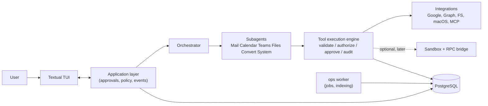

# opsagent

**A terminal-native personal operations agent: Gmail, Calendar, Teams, files, and macOS, driven by natural language, with human approval on anything that matters.**

> **Project status: pre-implementation (design phase).** The repository currently contains only documentation. Every command, path, and feature below is the **proposed contract** from [ARCHITECTURE.md](ARCHITECTURE.md). Nothing is implemented yet unless marked ✅ in [Features](#3-features). `opsagent` / `ops` is a working title.

Badges are intentionally omitted until CI, a published package, and a license exist.

---

## 1. Overview

`opsagent` is an agentic environment, not a chatbot. You describe intent; an orchestrator plans the work and delegates to specialized subagents (Mail, Calendar, Teams, Files, Convert, System). Side effects pass through a single execution engine with risk-based approval, payload-bound approvals, resumable state in PostgreSQL, and audit records.

Product vision and non-negotiable principles: **[MISSION.md](MISSION.md)**.

## 2. Architecture at a Glance



- Strict modular monolith; separate processes only for the worker, the optional sandbox, and external MCP servers.
- Details, diagrams, state machines, and constraints: **[ARCHITECTURE.md](ARCHITECTURE.md)**.

## 3. Features

Legend: ✅ implemented · 🚧 in progress · 📋 planned

| Area | Capability | Status |
|---|---|---|
| Foundation | Layered skeleton, import contracts, config, logging | ✅ |
| Foundation | PostgreSQL schema + migrations | ✅ |
| TUI | Chat, streaming, tool/subagent blocks, status line (runs against a scripted fake agent: `uv run ops --demo`) | ✅ |
| TUI | Approval panel (approve / edit / reject) | ✅ |
| TUI | Diff view, transcript search, text selection | 📋 |
| Agent | Orchestrator + todo planning | 📋 |
| Agent | Subagents: Mail, Calendar, Teams, Files, Convert, System | 📋 |
| Tools | Registry, validation, risk classification, audit | 📋 |
| Tools | Dynamic `search_tools` / `load_tools` | 📋 |
| Approvals | Policy engine, payload hashing, resume after approval | 📋 |
| Auth | Google OAuth (PKCE, Keychain) | 📋 |
| Auth | Microsoft Graph OAuth (work/school accounts) | 📋 |
| Mail / Calendar | Search, read, draft, send / list, create, update | 📋 |
| Teams | Read, send | 📋 |
| Files | Multi-root search: live Spotlight + ripgrep by default; per-root pg_trgm accelerator; pgvector for meaning | 📋 |
| Files | Read / diff-edit / organize | 📋 |
| Convert | Document conversion | 📋 |
| macOS | Allowlisted automation | 📋 |
| Memory | Persistent memory with provenance and supersession | 📋 |
| Jobs | Scheduler, reminders, worker | 📋 |
| Integrations | MCP servers | 📋 |
| Programmatic execution | Sandbox + RPC tool bridge | 📋 (only if justified; see ARCHITECTURE §4.4) |

## 4. Repository Structure

**Proposed** (no directories exist yet; this is the target layout and must match ARCHITECTURE §2):

```text
.
├── MISSION.md
├── ARCHITECTURE.md
├── README.md
├── AGENTS.md                  # (planned) concise instructions for AI coding agents
├── pyproject.toml
├── .env.example
├── docker-compose.yml         # PostgreSQL + pgvector (default dev database)
├── alembic.ini
├── migrations/                # Alembic revisions (app tables)
├── docs/adr/                  # Architecture Decision Records (decisions that amend ARCHITECTURE.md)
├── src/opsagent/
│   ├── domain/                # Entities, risk/policy models, tool & approval contracts, ports. No I/O.
│   ├── application/           # Use cases, sessions/runs, approval broker, policy engine, event bus
│   ├── agents/                # Orchestrator, subagent definitions, prompts, context assembly
│   ├── tools/                 # Registry, discovery, validation, execution engine, normalization
│   │   └── namespaces/        # mail/ calendar/ teams/ files/ convert/ system/ (ToolSpecs only)
│   ├── integrations/          # Adapters implementing ports: google/, microsoft/, filesystem/, macos/, convert/, web/, mcp/, llm/
│   ├── persistence/           # Repositories, checkpointer/store wiring, migrations glue
│   ├── presentation/tui/      # Textual app, screens, widgets, state reducers, theme/
│   ├── sandbox/               # Host-side RPC bridge, worker entrypoint, Ops SDK (deferred)
│   ├── workers/               # Job runner, indexer, filesystem watcher
│   ├── infra/                 # Config, logging, secrets (Keychain), HTTP, clock
│   ├── bootstrap/             # Composition root: wires adapters to ports
│   └── cli.py                 # `ops` entrypoint
├── tests/
│   ├── unit/  integration/  architecture/  evals/  security/  fixtures/
└── scripts/                   # Dev helpers
```

| Directory | Responsibility | Must not |
|---|---|---|
| `domain/` | Pure types and ports | Import anything outside stdlib/pydantic/the repo's own domain |
| `application/` | Orchestrates use cases, owns approvals/policy | Contain provider calls or UI code |
| `tools/` | The only path to integration adapters (via the engine) | Be bypassed by agents or UI |
| `integrations/` | Provider-specific code | Be imported except by `bootstrap/` |
| `presentation/` | Rendering and input | Contain business logic |

## 5. Technology Stack

Selected direction (versions are resolved at implementation time and pinned in `pyproject.toml`/lockfile; see ARCHITECTURE §17.3):

| Concern | Choice |
|---|---|
| Language | Python |
| Agents | LangChain `create_agent` on LangGraph, behind `AgentRuntime` (ADR 0003; DeepAgents deferred) |
| LLM | Google Gemini 3.x family (model IDs in config) via LangChain integration, behind a provider port |
| TUI | Textual |
| Database | PostgreSQL + `pgvector` + `pg_trgm` (built-in FTS for memory only) |
| Persistence for agents | LangGraph PostgreSQL checkpointer and store |
| Migrations | Alembic |
| File search | Spotlight (`mdfind`), `ripgrep`, PostgreSQL indexes, FSEvents-based watching |
| Integrations | Google APIs, Microsoft Graph (MSAL), MCP |
| Secrets | macOS Keychain (`keyring`) |
| Tooling | `uv`, `ruff`, `mypy` (or `pyright`), `pytest`, `import-linter` |

## 6. Prerequisites

| Requirement | Mandatory? | Notes |
|---|---|---|
| macOS (current major release) | **Yes** | Spotlight, FSEvents, Keychain, automation. Linux/Windows unsupported. |
| Python | **Yes** | Minimum version is set by the pinned dependencies; target the latest stable supported by DeepAgents/LangGraph. |
| `uv` package manager | **Yes** | |
| PostgreSQL (16+ recommended) | **Yes** | With extensions `vector` (pgvector) and `pg_trgm`. |
| `ripgrep` | **Yes** | |
| Gemini API access | **Yes** | API key from Google AI Studio or Google Cloud. |
| Google Cloud project with OAuth **Desktop** client | Optional (Gmail/Calendar) | Enable Gmail API and Calendar API. |
| Microsoft Entra app registration (public client) | Optional (Teams) | Work or school account required; admin consent may be needed. |
| macOS permissions (Full Disk Access / Automation, as needed) | Optional | Only for features that need them. |
| Container runtime or OS sandbox | Optional | Only if sandboxed programmatic execution is enabled (backend TBD). |
| Document converters, OCR engine | Optional | Decided at implementation time. |

## 7. Installation

> Commands are the proposed workflow. Package names (e.g., Homebrew formulas for pgvector) must be checked when you first run them.

```bash
# 1. Clone
git clone <repository-url> opsagent && cd opsagent

# 2. Tooling
brew install uv ripgrep                            # verify formula names/versions

# 3. Project environment and dependencies
uv sync

# 4. Database (default: docker-compose ships PostgreSQL with pgvector; extensions enabled by init script)
docker compose up -d db
# Alternative, native: brew install postgresql@16 pgvector, then
#   createdb opsagent && psql opsagent -c 'CREATE EXTENSION IF NOT EXISTS vector;' -c 'CREATE EXTENSION IF NOT EXISTS pg_trgm;'

# 5. Configuration
cp .env.example .env        # then edit (see below)

# 6. Migrations
uv run ops db migrate

# 7. Verify
uv run ops doctor
```

## 8. Configuration and Environment Variables

Application config lives in `.env` (development) and `~/.config/opsagent/` (policy, allowed roots). **OAuth refresh tokens and API keys are not stored in `.env` in normal use**; they go to the macOS Keychain via `ops auth ...`. A development-only env fallback for the Gemini key is allowed.

`.env.example` (proposed):

```dotenv
# --- Database ---------------------------------------------------------------
OPS_DATABASE_URL=postgresql://localhost:5432/opsagent
OPS_DB_POOL_MAX=10

# --- Models (IDs are configuration; check provider docs for current IDs) -----
OPS_MODEL_ORCHESTRATOR=            # e.g. a Gemini 3.x Pro/Flash model ID
OPS_MODEL_SUBAGENT=                # cheaper/faster tier for subagents
OPS_REASONING_ORCHESTRATOR=        # minimal|low|medium|high|xhigh (must be in the model profile)
OPS_REASONING_SUBAGENT=            # usually low or medium
OPS_REASONING_UTILITY=             # routing/titles/summaries: minimal or low
OPS_INCLUDE_THOUGHTS=true          # show collapsed thought summaries in the TUI
# Gemini 2.5 only: OPS_THINKING_BUDGET=  (0 off, -1 dynamic, or token cap)
OPS_MODEL_EMBEDDING=
OPS_EMBEDDING_DIMENSIONS=
# Dev-only fallback; prefer: ops auth gemini  (stores key in Keychain)
# GEMINI_API_KEY=

# --- Google OAuth (Desktop client; client ID is not a secret) ----------------
OPS_GOOGLE_CLIENT_ID=
OPS_GOOGLE_CLIENT_SECRET=          # Desktop clients are public clients; PKCE is always used

# --- Microsoft Graph (public client) ----------------------------------------
OPS_MS_CLIENT_ID=
OPS_MS_TENANT=organizations

# --- Filesystem --------------------------------------------------------------
OPS_ALLOWED_ROOTS=~/Documents:~/Desktop:~/Projects
OPS_DENY_PATTERNS=                 # additional denylist globs (defaults always apply)
OPS_INDEXING_ENABLED=true
OPS_OCR_ENABLED=false

# --- Agent limits ------------------------------------------------------------
OPS_MAX_PARALLEL_SUBAGENTS=3
OPS_RUN_DEADLINE_SECONDS=900
OPS_RUN_TOKEN_BUDGET=

# --- Approvals (stricter-only overrides; defaults in policy.toml) ------------
OPS_APPROVAL_TTL_R3_SECONDS=3600

# --- Time --------------------------------------------------------------------
OPS_TIMEZONE=                      # IANA name; defaults to system zone

# --- Sandbox (optional, deferred) -------------------------------------------
OPS_SANDBOX_ENABLED=false

# --- Observability -----------------------------------------------------------
OPS_LOG_LEVEL=INFO
OPS_LOG_DIR=~/Library/Logs/opsagent
```

| Variable group | Purpose |
|---|---|
| `OPS_DATABASE_URL` | PostgreSQL connection (required) |
| `OPS_MODEL_*` | Model selection; no defaults baked into code |
| `OPS_GOOGLE_*`, `OPS_MS_*` | OAuth client identification only |
| `OPS_ALLOWED_ROOTS`, `OPS_DENY_PATTERNS` | Filesystem boundary |
| `OPS_MAX_*`, `OPS_RUN_*` | Execution limits |
| `OPS_APPROVAL_*` | Approval timing (can tighten policy, never loosen it from the model side) |

Approval policy itself is edited with `ops policy ...` (user-only, audited), not through the agent.

## 9. External Integrations Setup

| Integration | Setup outline | Docs |
|---|---|---|
| **Gemini** | Create an API key; run `ops auth gemini`. Choose model IDs from the current model list and set `OPS_MODEL_*`. | https://ai.google.dev/gemini-api/docs |
| **Google OAuth** | In Google Cloud: create a project, configure the consent screen, create an OAuth client of type **Desktop app**, copy the client ID/secret into `.env`. | https://developers.google.com/identity/protocols/oauth2/native-app |
| **Gmail** | Enable the Gmail API; grant scopes incrementally with `ops auth google --capability mail-read` (then `mail-compose`, `mail-send` as needed). | https://developers.google.com/gmail/api |
| **Google Calendar** | Enable the Calendar API; `ops auth google --capability calendar-read|calendar-write`. | https://developers.google.com/calendar/api |
| **Microsoft Graph** | Entra ID → App registrations → new public client; add delegated permissions (least-privileged for the features you enable); set redirect to loopback; `ops auth microsoft`. Work/school account only. | https://learn.microsoft.com/graph/api/chatmessage-post |
| **MCP (optional)** | Add allowlisted servers in `~/.config/opsagent/mcp.toml`; each tool is classified before use (default high risk). | https://modelcontextprotocol.io |
| **macOS permissions** | Grant Terminal/iTerm the required privacy permissions (Full Disk Access, Automation) only for features you enable. | System Settings → Privacy & Security |
| **Sandbox (optional)** | Disabled by default; enabling requires the backend chosen in an ADR. | ARCHITECTURE §4.4 |

## 10. Running the Application

```bash
uv run ops                    # start the interactive TUI
uv run ops resume             # pick up an unfinished session / pending approvals
uv run ops worker             # start the background worker (jobs, indexing, watcher)
uv run ops db migrate         # apply database migrations
uv run ops doctor             # health: DB, extensions, credentials, integrations, ripgrep, index lag
uv run ops auth status        # integration states (CONNECTED / NEEDS_REAUTH / NEEDS_SCOPE)
uv run ops --help             # CLI help
```

Run `ops worker` in a separate terminal or as a launchd agent so scheduled jobs and indexing continue when the TUI is closed.

## 11. Usage Examples

> **All examples below are 📋 planned.** None work yet. They show the intended behaviour and approval flow.

```text
> What's on my calendar tomorrow, and are there conflicts?
  → Calendar subagent (read-only, automatic). Summarizes with time zone shown.

> Find unread emails from the vendor about invoice 4471 and draft a reply asking for the PO number.
  → Mail subagent: search + read (automatic); draft created (policy-dependent).
  → "Send it" → approval panel shows recipients, subject, body; [a]pprove / [e]dit / [r]eject.

> Move Thursday's design review to Friday 11:00 and tell the attendees.
  → Calendar: proposed update shown (attendees notified ⇒ approval required).
  → Teams: message to attendees proposed; separate approval.

> Find last quarter's vendor contract and convert it to PDF.
  → Files subagent: tiered search (fuzzy name + semantic), freshness-checked.
  → Convert subagent: writes PDF to the output directory.

> In ~/Projects/notes, replace "Q3" with "Q4" in all markdown files.
  → Files: itemized diffs; approval required outside designated workspace;
    approved edits apply only if files are unchanged since preview.

> Remind me Monday 09:00 to review the Teams thread with Priya.
  → Scheduled job (timezone-aware). Fires via `ops worker`.

> Every weekday 08:30 summarize unread mail from my manager.
  → Recurring scheduled job; any outgoing action still requires approval.
```

## 12. Development Workflow

> Targets below are proposed; the first implementation PR establishes them.

| Task | Command |
|---|---|
| Format | `uv run ruff format .` |
| Lint | `uv run ruff check .` |
| Type check | `uv run mypy src` (or the chosen checker) |
| Tests | `uv run pytest` |
| Architecture rules | `uv run lint-imports` |
| New migration | `uv run alembic revision -m "<msg>"` then review; apply with `ops db migrate` |
| Debug logs | `OPS_LOG_LEVEL=DEBUG` and inspect `OPS_LOG_DIR` (logs never print into the TUI) |
| TUI dev | `uv run ops --demo` replays scripted scenarios (type `stream`, `tools`, `approval`, `error`, or `long`) |

**Conventions:** typed Python, Pydantic models at boundaries, no module-level mutable state, no provider imports outside `integrations/`, no business logic in `presentation/`.

**Adding things (always in this order):**

1. **A module:** pick the layer (ARCHITECTURE §2); expose a public API in `__init__.py`; add an import-linter contract if it introduces a new boundary.
2. **A tool:** define a `ToolSpec` in `tools/namespaces/<ns>/` (schemas, default risk, risk classifier, idempotency, retry, timeout, redactions) → register it → add validation, risk, approval, and idempotency tests. Tools must not be callable except through the engine.
3. **A subagent:** declare name, description, prompt, owned namespace, always-loaded tools, model tier; add result-contract and eval scenarios. Subagents cannot spawn subagents.
4. **An integration:** define/extend a **port in `domain/`** → implement the adapter in `integrations/` → wire in `bootstrap/` → document auth scopes and failure modes → add contract tests and failure-injection tests.
5. **A migration:** schema change via Alembic; never hand-edit LangGraph-managed tables.

## 13. Testing

| Suite | Location | Purpose |
|---|---|---|
| Unit | `tests/unit/` | Domain logic: policy, risk, hashing, RRF, recurrence/DST, state machines |
| Architecture | `tests/architecture/` | `import-linter` contracts |
| Integration | `tests/integration/` | Real PostgreSQL + extensions, adapters with fixtures, headless TUI |
| Evals | `tests/evals/` | Agent workflow scenarios and retrieval benchmarks (golden datasets) |
| Security | `tests/security/` | Injection corpus, path traversal, secret-leak scans |
| Fixtures | `tests/fixtures/` | Recorded provider responses (scrubbed) |

```bash
uv run pytest                          # default suite (no network, no real providers)
uv run pytest tests/integration        # needs local PostgreSQL with extensions
uv run pytest tests/evals -m evals     # evals (may call real models; opt-in, costs money)
```

Strategy detail: [ARCHITECTURE.md §16](ARCHITECTURE.md#16-testing-and-evaluation).

## 14. Security

- **Credentials:** refresh tokens and API keys live in macOS Keychain; never in the database, logs, prompts, tool outputs, or sandbox. → [§6](ARCHITECTURE.md#6-authentication-and-integration-lifecycle), [§14](ARCHITECTURE.md#14-security-and-trust-boundaries)
- **Approvals:** risk-classified; sends and deletes always require approval; approvals are bound to the exact payload and single-use; the model cannot change policy. → [§5](ARCHITECTURE.md#5-human-in-the-loop-approval-architecture)
- **Filesystem:** allowed roots plus a denylist, enforced in code after symlink resolution. → [§7–8](ARCHITECTURE.md#7-external-integration-architecture)
- **Untrusted content:** email, documents, and web pages are data; reading them escalates approval requirements for outgoing actions. → [§14.4](ARCHITECTURE.md#144-taint-escalation-concrete-mechanism)
- **Sandbox (deferred):** isolated process, no secrets, no network, every operation re-validated by the host. → [§4.4](ARCHITECTURE.md#44-advanced-programmatic-execution-deferred)

Report vulnerabilities privately to the maintainers (add a `SECURITY.md` with contact details before the first release).

## 15. Documentation Index

| Document | Contents |
|---|---|
| [MISSION.md](MISSION.md) | Identity, vision, principles, agent behaviour contract, trust philosophy |
| [ARCHITECTURE.md](ARCHITECTURE.md) | Authoritative technical design |
| `AGENTS.md` | *Planned.* Short operating rules for AI coding agents; must defer to the documents above |
| `docs/adr/` | *Planned.* Decision records that amend or extend the architecture |

## 16. Contributing and Engineering Standards

For contributors and AI coding agents:

1. **Read `MISSION.md` and `ARCHITECTURE.md` first.** If a change conflicts with them, write an ADR before coding.
2. **Do not invent architecture.** If the documents are silent, choose the simplest option consistent with the layering rules and record the decision.
3. **Respect module boundaries.** CI enforces import contracts; do not suppress them.
4. **Everything with side effects goes through the execution engine.** No direct adapter calls from agents, UI, workers, or sandbox code.
5. **Never weaken approval or trust rules for convenience.** Tightening is fine; loosening requires an ADR and tests.
6. **Do not hardcode model IDs, versions, secrets, or paths.** Configuration only.
7. **Tests with the change.** New tool ⇒ validation/risk/approval/idempotency tests; new integration ⇒ contract and failure-injection tests; new retrieval behaviour ⇒ benchmark cases.
8. **Keep docs truthful.** Update the feature status table and repository tree in the same PR as the code. Do not mark something ✅ until it is merged, tested, and runnable.
9. **Keep documents non-duplicative:** product intent → MISSION; design → ARCHITECTURE; commands/layout → README.

## 17. Current Limitations and Roadmap

**Current limitations**

- No implementation exists; this repository defines design and process only.
- macOS only. Teams requires a work/school account (personal Microsoft accounts are not supported by the Graph chat-send APIs) and may require tenant admin consent.
- Requires a local PostgreSQL installation with extensions.
- Several technical choices are intentionally unresolved (sandbox backend, vector index type, converters, OCR, web search provider); see [ARCHITECTURE §17.3](ARCHITECTURE.md#173-verification-status-and-open-decisions).
- Library and model versions have not been pinned or validated against each other yet.

**Roadmap (in order; see [ARCHITECTURE §17](ARCHITECTURE.md#17-architectural-evolution))**

0. Spikes (versions, DeepAgents lockdown, HITL resume, Textual feasibility)
1. Skeleton, config, DB, events, `ops doctor`, LLM and agent-runtime ports
2. TUI (Claude Code-style) on a scripted fake event stream
3. Tool registry + execution engine + first read-only subagent
4. Approval broker, policy engine, resume, startup reconciliation
5. Google and Microsoft auth lifecycle
6. Mail, Calendar, Teams, Files, Convert, System subagents
7. Background jobs, scheduler, worker
8. Filesystem search: live tiers first, then per-root accelerator and semantic index
9. Persistent memory
10. Dynamic tool discovery (only if measured need)
11. MCP integrations
12. Sandboxed programmatic execution — only with evidence of need

Per-phase plans: [phases/](phases/00-verdict.md).

License: *to be decided before the first release.*
